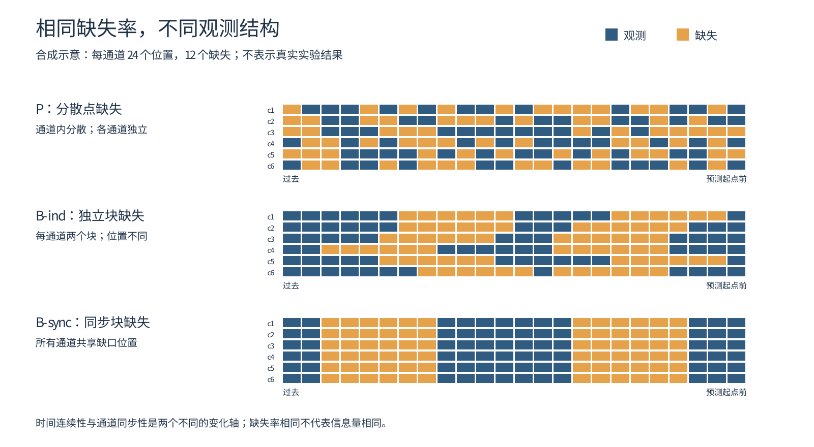

# 跨领域文献调研：训练与测试缺失模式不一致

调研日期：2026-11-19。对象：多变量时间序列预测中的 P↔B 缺失模式变化；同时关注跨变量同步性变化。本文为有针对性的跨领域范围综述，不声称穷尽文献或完成 PRISMA 系统综述。

配套文件：[论文元数据与证据等级](literature_sources/1119_cross_domain_missingness_shift/references.json)、[检索记录](literature_sources/1119_cross_domain_missingness_shift/search_log.json)、[DOI 核验](literature_sources/1119_cross_domain_missingness_shift/citation_verification.json)、[BibTeX](literature_sources/1119_cross_domain_missingness_shift/references.bib)、[PDF](1119-文献调研-跨领域缺失模式变化.pdf)。

## 1. 先回答问题

**其他领域存在非常相近的问题，而且已有论文直接把“训练与测试掩码分布不同”作为研究对象。** 最值得连接的不是泛泛的“缺失数据处理”，而是以下五条线：

| 领域 | 与本课题对应的变化 | 已有解决思路 | 对应程度 |
| --- | --- | --- | --- |
| 图像修复 | 零散缺像素、细笔刷缺口 → 大面积孔洞、条纹、半图缺失 | 无条件生成先验 + 按实际掩码推断；全局感受野；掩码增强 | RePaint 明确研究未见掩码；LaMa 等主要提供机制启发 |
| 加速 MRI 重建 | 一种欠采样方式 → 另一种采样位置/轨迹；相同采样量也可有不同结构 | 图像先验与观测算子分离；数据一致性；采样掩码编码 | 很接近“采集方式改变而信号规律相对稳定” |
| 表格与医疗预测 | 医院、记录政策、设备变化导致缺失分布改变 | 每个掩码下的条件预测器共享；稳定相关性保留；缺失条件嵌入 | 数学问题最直接对应，但通常不研究时间几何 |
| 3D 点云 | 全局随机丢点 Drop Global → 局部成片丢点 Drop Local | 几何感知结构；结构化增强；按损坏类型评估 | “散点 vs 成块”形态几乎对应；原论文主要是干净训练后的鲁棒性评估 |
| 语音通信 | 孤立随机丢包 → 连续突发丢包 | 真实网络轨迹训练/评测；上下文与生成模型；仅用已接收数据的测试时适应 | 时间形态最直接；任务多为缺口恢复，不是预测完整未来 |

多模态学习还提供第六条线：完整模态或随机模态删除训练后，测试时某个传感器/模态永久不可用。它与整变量缺失接近，与所有变量在同一时间段共同缺失并不等价。

本次最有价值的具体论文是：**RePaint [R08]、Score-MRI [R12]、StableMiss+ [R02]、NeuMISE [R04]、MIRRAMS [R05]**。若重点讨论“训练只能使用不完整历史”，补读 **Ambient Diffusion [R14]**；若重点设计 P/B 与同步性评测，补读 **点云鲁棒性 [R17] 和语音 PLC 挑战 [R18–R19]**。

## 2. 与项目当前问题对齐

### 2.1 已读的本地依据

- [1113 统一框架结果](1113-实验结果-统一框架-r50-2x2矩阵.md)：P→P、P→B、B→P、B→B；不同模型、不同数据集的失配效应不一致，不能预设“块缺失总更难”。
- [1114 结构化掩码训练讨论](1114-研究路线-结构化掩码鲁棒训练与重要性扰动.md)：区分单模式迁移诊断与已覆盖多模式的鲁棒训练。
- [1119 后验推断实验计划](ocpe/1119-实验计划-观测条件后验推断与轻量S4验证.md)：普通 S4 前接线性高斯后验；核心协议为 L=H=96、逐变量精确缺失 48 点、B 为两个严格分离的 24 步块。训练不使用被掩去历史真值作为监督；未来预测标签完整。

旧结果中的 B 采样器与最新严格分离协议存在版本区别，本文只用旧报告了解问题，不重新解释旧数值为新协议实验结果，也不改变正在运行的实验。

### 2.2 更准确的数学定位

设完整历史为 \(X\in\mathbb R^{L\times C}\)，未来为 \(Y\)，\(M=1\) 表示观测。环境 \(e\) 中：

\[
p_e(X,Y,M)=p(X,Y)\,q_e(M\mid X,Y).
\]

本项目当前的人工掩码与数据值独立，因此属于 \(q_e(M)\) 变化。P/B 改变掩码的时间相关结构；B-ind/B-sync 改变通道间的联合结构。**块内掩码彼此相关，不等于 MNAR：只要整个掩码与数据值独立，仍可属于 MCAR。**

因此，本问题可以定位为：

> 在完整信号—未来关系相对稳定时，对观测算子的时间结构及跨变量联合结构变化进行泛化。

“相同缺失率”只约束观测数量，不约束信息量、最长缺口、最近观测距离或不同通道是否能相互补偿。

当前 P 从每变量所有 48 点缺失组合中抽样，理论上也可能偶然抽到 B 形状，只是这类结构在高维联合掩码中极罕见。因此“未见块模式”主要指有限训练中未有效覆盖这种几何族，不应未经检查就声称源、目标的数学支持完全不相交。反过来，若某种目标观测配置在源数据中确实不可识别，也不能指望仅靠源风险最小化或重加权自动恢复它。

图 1 为合成示意，不是实验结果。每行 24 个位置、缺失 12 个；块缺失为两个长度 6 的块，对应项目 96/48/B24 设置的缩小示意。

### 2.3 文献证据如何分级

- **A：直接研究错配。** 论文明确讨论训练—测试缺失/采样分布不同，或专门研究测试阶段的新缺失配置。
- **B：推断过程可接收不同观测算子。** 不需要按每个掩码重训，但先验训练可能依赖完整数据。
- **C：相邻机制或评测启发。** 支持多种缺失、提高大缺口性能、或提供鲁棒性基准；本身不等于证明 P-only→B 有效。

另记录阅读深度：全文核查或仅核查官方摘要。上述等级是与课题的相关性分类，不是论文质量排名。

## 3. 最接近的跨领域工作

### 3.1 图像修复：RePaint 是最直接的 CV 对应

**[R08] RePaint: Inpainting Using Denoising Diffusion Probabilistic Models，CVPR 2022。** [论文](https://openaccess.thecvf.com/content/CVPR2022/html/Lugmayr_RePaint_Inpainting_Using_Denoising_Diffusion_Probabilistic_Models_CVPR_2022_paper.html)；[作者代码](https://github.com/andreas128/RePaint)。证据 A+B；已读全文。

论文明确指出：针对特定掩码分布训练的修复模型，对新掩码类型泛化有限。其关键选择是使用预训练的**无条件 DDPM**，在反向生成时结合当前可见区域，并通过反复加噪、去噪的 resampling 改善已知区与生成区的协调。实验覆盖六类标准及极端掩码，包括细/粗缺口、规则稀疏观测、半图与外扩情形；并非只改变缺失比例。

**可借鉴的研究思想：**学习“信号通常是什么样”与“这次哪些位置可见”两件事分开。新掩码通过推断过程进入，而不是完全依赖一个在源掩码上学到的填补映射。

**与本项目的差别：**RePaint 没有进行“P-only 缺失历史训练”。其先验见过完整训练图像；目标是感知质量与多样性，不能由此推导未来预测 MSE 一定降低。其迭代采样开销也明显高于一次前向预测。

**[R09] A Theoretical Justification for Image Inpainting using Denoising Diffusion Probabilistic Models，2023 预印本。** [论文](https://arxiv.org/abs/2302.01217)。证据 B；已核查理论范围。

该文分析 RePaint 的对齐偏差并提出 RePaint+，在线性模型/子空间假设及可恢复条件下给出恢复与收敛结果。它支持研究“一个先验配多个掩码”的理论问题，**不是任意真实信号、任意掩码均可恢复的证明**。

### 3.2 LaMa 与 Partial Convolution：解释为什么块缺失需要不同归纳偏置

**[R06] Image Inpainting for Irregular Holes Using Partial Convolutions，ECCV 2018。** [论文](https://arxiv.org/abs/1804.07723)。证据 C；核查作者摘要和官方项目说明。

Partial Convolution 只用有效像素计算局部响应，并按有效像素数量归一化，同时更新后续层的掩码。它处理的是填充值污染卷积的问题，可启发“有效观测归一化”的时序局部算子。它本身不能证明长块缺口下仍有足够上下文；后续层更新为有效也不表示获得了新的真实观测。

**[R07] Resolution-Robust Large Mask Inpainting With Fourier Convolutions（LaMa），WACV 2022。** [论文](https://arxiv.org/abs/2109.07161)；[代码](https://github.com/saic-mdal/lama)。证据 C；已读全文。

LaMa 将大缺口困难与有效感受野不足联系起来，结合 Fourier Convolution 的全局交互、大感受野感知损失及大掩码训练。对本课题的启发是：散点缺失时邻域常仍含信息，长缺口则需要更远时间或其他变量的支持。**大掩码已进入其训练，不能把效果当成 P-only→未见 B 的证据。** 全局结构也只是可检验的解释，不保证任何数据集上的块缺失都更难。

### 3.3 MRI：采样模式变化比一般图像复原更接近采集系统变化

MRI 通常可写为 \(y=P_\Omega F x+\epsilon\)，其中 \(F\) 是傅里叶算子，\(P_\Omega\) 选择实际采样位置。与本项目的共同点是观测位置改变；区别是 MRI 多在频域采样，不能把 k-space 的局部缺口直接等同于时间域连续缺口。

**[R12] Score-based diffusion models for accelerated MRI，Medical Image Analysis 2022。** [论文](https://arxiv.org/abs/2110.05243)；[出版记录](https://pubmed.ncbi.nlm.nih.gov/35696876/)；[代码](https://github.com/hyungjin-chung/score-MRI)。证据 A+B；已读全文。

方法用完整幅值图像学习 score prior，推断时在采样更新与数据一致性更新之间交替。全文比较不同采样结构，例如一维随机采样、二维 Gaussian、均匀随机与 Poisson 类采样，不要求为每个采样模式重新训练先验。这是“保持信号先验、改变观测算子”的强参考。

**可迁移部分：**显式输入真实掩码/观测算子；由当前可见观测更新状态；保留推断不确定性。**不能直接迁移部分：**完整图像先验的训练权限、频域物理结构及迭代计算预算。论文也针对不同采样设置讨论不同推断实现，不能理解为所有场景都无需任何算法配置选择。

**[R13] Encoding sampling pattern for robust and generalized MRI reconstruction，Pattern Recognition 2025。** [出版方页面](https://www.sciencedirect.com/science/article/pii/S0031320325004327)。证据 A；仅核查出版方摘要与 highlights。

其 MXNet 明确针对训练与测试采样设置不同的问题，把采样模式编码及物理约束纳入展开网络，并联系掩码估计与图像恢复。可以借鉴结构化的掩码表示及观测模型，但本项目已有准确掩码，不必引入“估计掩码”的额外问题。由于未获取该文完整实验，本报告不声称其已验证某个具体等采样量的模式迁移矩阵。

### 3.4 更一般的逆问题：DDRM 与 DPS

**[R10] Denoising Diffusion Restoration Models（DDRM），NeurIPS 2022。** [论文](https://arxiv.org/abs/2201.11793)；[作者项目](https://ddrm-ml.github.io/)。证据 B；核查作者摘要和项目。

DDRM 用预训练扩散先验求解不同线性观测算子的恢复问题，包括修复、去模糊与超分辨率。其重要性在于“先验复用、观测算子显式进入推断”，不是其具体图像网络可以直接预测时序。

**[R11] Diffusion Posterior Sampling for General Noisy Inverse Problems（DPS），ICLR 2023。** [论文](https://arxiv.org/abs/2209.14687)；[代码](https://github.com/DPS2022/diffusion-posterior-sampling)。证据 B；核查作者摘要与论文开篇。

DPS 通过近似似然引导处理带噪声的线性/非线性逆问题。它提示设备故障若同时改变噪声，观测置信度也值得建模。但它是**近似后验采样**，不应把生成结果或采样方差直接视为已校准的真实后验。

### 3.5 表格与医疗预测：数学上直接研究 missingness shift

**[R01] Prediction with Incomplete Data under Agnostic Mask Distribution Shift（StableMiss），IJCAI 2023。** [论文](https://www.ijcai.org/proceedings/2023/525)。证据 A。

该文明确设定完整特征—标签分布不变、掩码分布未知地改变，通过双参数化共享不同掩码的预测器，并抑制可能随掩码分布变化的关联。它是项目问题定义的直接前作。它不等于已解决长时间块、同步缺失和高维时序的泛化。

**[R02] StableMiss+: Prediction with Incomplete Data Under Agnostic Mask Distribution Shift，ICASSP 2024。** [作者全文](https://jhc.sjtu.edu.cn/~bjiang/papers/Zhu_ICASSP2024_StableMiss%2B.pdf)。证据 A；已读全文。

这是对项目既有 StableMiss 引用的重要补充：原方法的去相关可能同时损伤稳定且有用的特征相关性；StableMiss+ 尝试保留特征值之间的相关性，同时消除掩码内部及特征—掩码的不稳定关联。

**对本课题尤其重要：**跨变量相关性本来就是缺失补偿来源，不能把“所有通道都去相关”当成鲁棒性目标。应区分数据生成中的稳定依赖，与由某种缺失或插补过程诱发的伪关联。这是方法设计启发，不是已经证明本项目应采用其具体重加权算法。

**[R03] Domain Adaptation under Missingness Shift，AISTATS 2023。** [论文](https://proceedings.mlr.press/v206/zhou23b.html)。证据 A；核查官方摘要。

该文考虑有标签源数据与无标签目标数据，分析缺失指示可得及 underreporting 等情形，给出识别和调整结果。它与采集政策变化直接相关，但**训练阶段可获得目标输入**，与本项目严格未知目标模式的泛化设置不同。未来若允许部署后适应，它可作为单独的 adaptation 路线。

**[R04] Robust prediction under missingness shifts（NeuMISE），2024 预印本。** [论文](https://arxiv.org/abs/2406.16484)。证据 A；已读全文。

论文区分可忽略与不可忽略的缺失变化，说明在适当条件下，同一掩码下的 Bayes 预测器保持稳定，但有限样本学习器仍可能不稳。NeuMISE 用类似迭代插补的嵌入在缺失维度中更新信息，并保留观测值；完整输入时可直接传递原值。全文也观察到失配方向会影响方法表现。

它对本项目有两层价值：为“完整规律不变但观测改变”提供理论定位；提醒结构应在观测数量/组合变化时仍有合理行为。不过，原实验主要考察缺失比例、机制与完整输入外推，不能将其结论直接写成对等缺失率 P↔B 的验证。本文按可核实 arXiv 记录标为预印本，不将搜索中的投稿 PDF 当作已接收会议论文。

**[R05] MIRRAMS: Learning Robust Tabular Models under Unseen Missingness Shifts，2025 预印本。** [论文](https://arxiv.org/abs/2507.08280)。证据 A；已读 v2 全文。

方法以互信息条件为动机，使用额外遮挡、原输入/再遮挡输入的标签监督及高置信预测一致性等损失，不要求事先获得测试集。全文主要是表格分类，考察 MCAR/MAR/MNAR 和训练/测试缺失比例组合。

**可借鉴：**在不使用原本缺失真值的前提下，对已有观测再遮挡，约束预测保持有用信息。**迁移边界：**额外遮挡以独立 Bernoulli 形式构造，原实验不是连续时间块几何；分类的高置信伪标签也不能无修改搬到连续未来回归。“算法可用于多种机制”不等于对任意 MNAR 偏移存在无条件保证。

### 3.6 训练集也只有缺失数据：Ambient Diffusion 补足先验训练条件

**[R14] Ambient Diffusion: Learning Clean Distributions from Corrupted Data，NeurIPS 2023。** [论文](https://proceedings.neurips.cc/paper_files/paper/2023/hash/012af729c5d14d279581fc8a5db975a1-Abstract-Conference.html)。证据 C；已读全文。

它研究只用受损数据学习完整分布，核心是对已有观测进一步施加损坏，再利用原来可见的部分构造学习信号；在特定观测分布与可识别条件下建立条件期望结果。

它不是 P→B 预测论文，但比直接使用完整数据预训练的 RePaint 更接近当前信息约束。真正可借鉴的是“只在可见位置构造监督”的原则。它**不能凭空恢复训练中始终不可见、且无法由其他观测识别的信息**；也不能仅凭额外遮挡就保证跨时间块泛化。

### 3.7 多模态缺失：适合借鉴可用信息融合，不宜直接等同于同步块缺失

**[R15] HeMIS: Hetero-Modal Image Segmentation，MICCAI 2016。** [论文](https://arxiv.org/abs/1607.05194)。证据 C；已读全文。

HeMIS 分别编码模态，对可用模态的表示做均值、方差等统计聚合，再分割。训练经过完整模态预热后随机删除模态，推断接受可用模态子集。其价值是融合结果不必依赖固定通道数；其训练已经覆盖缺模态情况，不能直接当作未见缺失模式证据。

**[R16] SimMMDG: A Simple and Effective Framework for Multi-modal Domain Generalization，NeurIPS 2023。** [论文](https://papers.neurips.cc/paper_files/paper/2023/hash/f88bec15cc4cb56b432ee040bb63f94f-Abstract-Conference.html)；[代码](https://github.com/donghao51/SimMMDG)。证据 A；已读全文。

该文区分模态共享与模态特有表示，并用跨模态 translation 预测缺失模态的嵌入。正文专门讨论训练模态完整、测试部分模态缺失；其 missing-modality 实验另训练 translation MLP，不能忽略这项额外训练。

这支持“某通道缺失时从其他通道提供替代信息”，但当 B-sync 使所有通道同一时段都不可见时，同期跨通道翻译也没有输入可用，需要过去时间或其他结构支持。模态缺失、通道缺失、跨通道同步的时间块缺失应分别实验。

### 3.8 3D 点云：散点丢失与局部成片丢失有明确命名

**[R17] Benchmarking and Analyzing Point Cloud Classification under Corruptions，ICML 2022。** [论文](https://proceedings.mlr.press/v162/ren22c.html)；[项目细节](https://pointcloud-c.github.io/details.html)。证据 C；已读全文。

其 ModelNet-C 中直接区分：

- **Drop Global：**从整个点云随机删点，对应“散点缺失”。
- **Drop Local：**删除若干 k-NN 局部簇，对应“成块缺失”。

论文研究结构、预训练与增强对各类损坏的不同影响，并提出 RPC、WOLFMix 等改进。这是很适合引用的跨领域几何类比。

**注意评测含义：**其重点是常规模型对损坏的 OOD 鲁棒性，不是固定缺失预算的 Drop-G-only 训练→Drop-L 测试矩阵。不同损坏等级也不自动保证删除点数相同。可借其分类和逐类型报告方式，不能直接拿其表格证明等预算的模式迁移代价。

另外，ICML 2022 的三作者论文与后续四作者 PointCloud-C 扩展稿题名不同，本报告引用正式 ICML 论文，避免混写元数据。

### 3.9 语音通信：随机丢包与连续突发丢包是时间形态上的强对应

**[R18] INTERSPEECH 2022 Audio Deep Packet Loss Concealment Challenge。** [论文](https://www.isca-archive.org/interspeech_2022/diener22_interspeech.html)。证据 C；已读全文。

挑战把真实 Teams 网络丢包轨迹施加到公开语音上，除丢包比例外，还按最长突发长度分层；盲测包含不超过 120 ms、120–320 ms、320–1000 ms 等组。它说明应同时描述缺失数量与缺失连续性，并用真实轨迹检查人工独立丢失模型的代表性。

**[R19] The ICASSP 2024 Audio Deep Packet Loss Concealment Grand Challenge，IEEE OJSP 2025。** [作者接收稿](https://halcy.de/cites/pdf/diener2025icassp.pdf)。证据 C；已读全文。

后续挑战进一步包含最长 1000–3000 ms 的突发，并联合丢包比例组织测试。**题名中的 2024 是挑战年份，正式论文年份为 2025。**

对本项目的启发是：除固定两个 B24 外，还可报告最长缺口、距预测起点最近观测的距离，并逐步引入真实故障轨迹。挑战论文并不直接证明“随机缺失训练可泛化到突发缺失”；它主要提供数据和评价方法。

**[R20] Self-Supervised Test-Time Tuning for Packet Loss Concealment（TTT-PLC），2026 预印本。** [论文](https://arxiv.org/abs/2607.01823)。证据 C；已读全文。

它只用收到的音频，再遮住其中一部分构造自监督，适应后修复真正丢失的包；另区分整文件的非因果适应与只更新已完成历史块的因果适应。它是值得关注的近期方法方向，但改善还可能来自对当前说话人/信号的适应，不能自动归因于解决了缺失模式变化。

迁移到预测任务时，需要明确只用预测起点以前的观测更新，并与参数冻结模型分开报告。这属于测试时适应，不能混入当前零适应 P↔B 主结果。

## 4. 20 篇论文的证据索引

| 编号 | 工作 | 等级 | 核查深度 | 是否直接提供本项目的等率 P↔B 预测证据 |
| --- | --- | --- | --- | --- |
| R01 | StableMiss，IJCAI 2023 | A | 官方摘要、扩展稿检索 | 否；定义直接相关 |
| R02 | StableMiss+，ICASSP 2024 | A | 全文 | 否；相关性保持很重要 |
| R03 | DAMS，AISTATS 2023 | A | 官方摘要 | 否；目标输入可用 |
| R04 | NeuMISE，2024 预印本 | A | 全文 | 否；比例/机制变化为主 |
| R05 | MIRRAMS，2025 预印本 | A | 全文 | 否；表格分类、额外随机遮挡 |
| R06 | Partial Convolution，ECCV 2018 | C | 作者摘要、官方说明 | 否；有效观测算子启发 |
| R07 | LaMa，WACV 2022 | C | 全文 | 否；大掩码训练 |
| R08 | RePaint，CVPR 2022 | A+B | 全文 | 否；直接研究图像新掩码 |
| R09 | RePaint+ 理论，2023 预印本 | B | 全文与假设 | 否；受限线性恢复理论 |
| R10 | DDRM，NeurIPS 2022 | B | 作者摘要、项目 | 否；通用线性恢复 |
| R11 | DPS，ICLR 2023 | B | 作者摘要、论文开篇 | 否；近似后验逆问题 |
| R12 | Score-MRI，MedIA 2022 | A+B | 全文 | 否；频域采样变化 |
| R13 | MXNet，Pattern Recognition 2025 | A | 出版方摘要 | 否；具体模式矩阵未全文核实 |
| R14 | Ambient Diffusion，NeurIPS 2023 | C | 全文 | 否；不完整数据学先验 |
| R15 | HeMIS，MICCAI 2016 | C | 全文 | 否；训练有模态删除 |
| R16 | SimMMDG，NeurIPS 2023 | A | 全文 | 否；完整→缺模态，并含内容域变化 |
| R17 | 点云损坏基准，ICML 2022 | C | 全文 | 否；随机丢点/局部丢点类比 |
| R18 | Audio PLC Challenge，Interspeech 2022 | C | 全文 | 否；真实突发缺失评测 |
| R19 | ICASSP 2024 PLC Challenge，OJSP 2025 | C | 全文 | 否；更长突发缺失 |
| R20 | TTT-PLC，2026 预印本 | C | 全文 | 否；测试时自监督适应 |

最后一列均为“否”不是文献不相关，而是避免把“有对应思想”错误升级为“已经验证本项目设定”。未找到完全同协议的工作，也不足以证明本项目具有首创性。

## 5. 文献对方法路线的共同启示

### 5.1 最值得借鉴的是“观测条件推断”，不必先上扩散模型

RePaint、Score-MRI、DDRM、DPS 的共同结构是：

1. 学习一个可复用的信号先验；
2. 用实际观测算子/掩码形成数据约束；
3. 在当前观测下推断未见信息，再完成任务。

对未来预测，可写为：

\[
p(Y\mid X_{\rm obs},M)
=\int p(Y\mid X_{\rm obs},X_{\rm mis},M)\,
p(X_{\rm mis}\mid X_{\rm obs},M)\,dX_{\rm mis}.
\]

在本项目的可忽略机制下，完整历史给定后可进一步使用 \(p(Y\mid X)\)。但实际学习只能近似上述分布，且先验可能设错。

这为当前 PU-S4 提供的是**共同设计原则**，不是“已有 CV 论文证明 PU-S4 会成功”。线性高斯前端可以先检验这一原则，计算更可控、信息边界也更容易核查。观测条件推断、后验均值和方差本身都有大量前作，不能作为独立的新颖性主张。

对当前线性高斯模型，后验精度矩阵形如：

\[
J(M)=I+\sum_{t,c}M_{t,c}\,
a_{t,c}a_{t,c}^{\mathsf T}/\sigma_c^2.
\]

同样数量的观测，因载荷 \(a_{t,c}\) 的方向与时间结构不同，可提供不同的潜在信息。这比“数一数还剩多少值”更贴近几何变化。若载荷完全不随时间变化且逐变量计数固定，最终精度甚至可能与 P/B 排列无关；因此需要项目计划中时间变化的载荷与真实数据验证，不能从公式直接断言 P/B 必有差异。

### 5.2 “掩码不变”应指规律可复用，不应强制所有观测下输出相同

缺失位置改变，实际可获得的信息也改变。强制 P 与 B 的所有表示或预测完全相等，可能抹掉合法信息、压低模型能力。

更合理的目标是：保留观测值，稳定利用可见信息，在信息减少时有合理退化；一致性损失应考虑所保留信息是否仍足以支持原预测。MIRRAMS 的分类高置信机制是一个具体设计，不是回归任务的现成答案。

同理，不应把“摆脱缺失模式伪相关”实现为完全删除掩码。掩码对于识别真实观测、决定条件推断以及计算不确定性仍然必要。

### 5.3 源数据已缺失时，额外遮挡存在一个硬约束

若原观测掩码为 \(M\)，合法的再遮挡只能得到：

\[
M'=M\odot A,\qquad M'\le M.
\]

如果还要求观测点数与原来完全相同，则只能有 \(M'=M\)。因此，**从一个已经 P50 缺失的样本出发，只删除现有观测，不能把它变成一个不同位置的纯 B50 样本。**

这直接影响训练策略解释：

- 原始完整训练段若可用于重新抽样 B 掩码，就形成“多模式训练”，要明确承认 B 已在训练出现。
- 严格 P-only 的不完整训练样本上追加块删除，会使总缺失率增加，得到带残余散点缺失的结构，而非纯 B50。
- 对这种增强，应加入相同最终缺失预算的随机再遮挡对照，区分信息减少、模式覆盖与损失函数的效果。
- Ambient Diffusion、MIRRAMS、TTT-PLC 的再遮挡思想不能绕开这个集合包含约束。

这一点比“增加随机掩码增强”更需要在本项目中写清楚。

### 5.4 结构化增强与严格未知模式泛化应分别报告

借鉴 LaMa、HeMIS 或点云增强是合理的，但至少应分成：

| 设置 | 训练时信息 | 能支持的结论 |
| --- | --- | --- |
| P-only→B；B-only→P | 仅源模式 | 跨模式泛化能力 |
| P/B 混合训练→P/B | 训练覆盖两类 | 已知模式族的鲁棒训练效果 |
| P/短块训练→未见长块 | 几何参数部分覆盖 | 块长度外推 |
| B-ind 训练→B-sync | 未见同步结构 | 跨变量联合缺失的迁移 |
| 部署后观测自监督更新 | 使用目标历史输入 | 测试时适应能力 |

无条件图像先验训练属于另一种训练资源设置，也要与上述源不完整数据协议分开。

## 6. 对本项目最具体的研究建议

以下是文献启发后的建议，不是本次启动的新实验。

**第一优先：继续用冻结的 PU-S4 / STAT-S4 / LI-S4 矩阵检验后验归纳偏置。** 这与跨领域最有说服力的“先验—观测约束分离”思路一致，而且已有参数量、辅助损失与信息权限控制。只有 V2 优于 V1，才更支持具体后验特征路径的价值；仅 V2 优于 V0 不够。

**第二优先：把几何变化拆开，而不是只换 P/B 标签。** 固定逐变量预算，分别改变最长缺口、块靠近预测起点的程度、跨变量同步性和块位置分布。现有 B-uniform 测试非常合适；再增加同步性时应独立登记，不与当前主协议混合。

**第三优先：增加简单且公平的再遮挡对照，之后再考虑互信息或对抗掩码。** 若后续研究训练策略，先比较等最终预算的随机再遮挡与结构化再遮挡；再考虑回归任务合适的一致性。不能使用原本缺失真值监督，也不宜把复杂互信息目标作为先验必胜方案。

**第四优先：当基本收益确认后，再考虑部署适应。** TTT-PLC 可启发只用已观测历史构造自监督，但要单列计算成本、参数更新、使用目标输入的权限及因果边界；当前主实验不应临时加此机制。

评价继续固定测试模式比较训练模式：

\[
\Delta_{A\to B}=R_B(f_A)-R_B(f_B).
\]

这里 \(f_B\) 是目标模式匹配训练的诊断参照，不是已知 Bayes oracle，差值允许为负。还应报告匹配精度、所有组的平均/最坏风险、模型对真实观测的响应及时间成本。两个训练种子分别配两个测试掩码，不构成四次独立训练重复。

## 7. 论文定位与阅读顺序

建议用以下逻辑组织 related work：

> 缺失感知预测处理输入不完整；missingness-shift 研究处理观测机制变化；图像修复与 MRI 展示先验—观测算子分离；点云和语音揭示随机删除与结构化删除的区别。本课题进一步在多变量预测中控制缺失率，研究时间连续性与跨变量同步性的变化，并在仅允许源不完整历史的训练条件下验证方法。

这是一种可辩护的定位，仍需与时序领域的直接前作继续查新。不能声称“首次提出训练测试缺失不同”，也不能把“标准后验 + S4”直接写成已确认方法创新。

推荐顺序：

1. **RePaint [R08]：**先看引言、方法、六类掩码实验；建立跨领域问题联系。
2. **Score-MRI [R12]：**看观测模型、数据一致性与跨采样模式实验。
3. **StableMiss+ [R02] 与 NeuMISE [R04]：**分别看稳定相关性应保留什么、哪些缺失变化下条件预测规律可保持。
4. **MIRRAMS [R05]：**看额外掩码、三项损失和训练/测试协议；重点审视分类到回归的迁移条件。
5. **Ambient Diffusion [R14]：**补足仅有不完整训练数据时的先验学习问题。
6. **点云 [R17]、PLC [R18–R19]：**借鉴结构化缺失类型与按连续缺口分层的评价。
7. **HeMIS / SimMMDG / TTT-PLC [R15–R16、R20]：**分别作为融合结构和部署适应的扩展阅读。

## 8. 检索、核验与局限

检索入口包括 arXiv、CVF Open Access、PMLR、NeurIPS/OpenReview、ISCA、PubMed 及出版方/作者页面；先用网页检索发现，再回到原论文核实。检索词、查询返回与日期见配套 JSON。不同入口并不意味着进行了彼此独立、全覆盖的数据库系统检索。

纳入原则：优先直接讨论缺失/掩码/采样变化的原始论文；其次纳入与 P/B 几何、跨通道缺失或训练信息权限直接相关的方法。排除泛泛的噪声鲁棒性、仅学习最优采样位置而不研究变化的方法，以及无法从一手来源验证的二手总结。mmFormer 等缺模态方法已发现，但与 HeMIS/SimMMDG 的作用重叠，本轮未扩展逐篇分析。

本次选入 20 篇问题/方法文献，其中 14 篇核查全文，其余标明摘要级或局部核查；不伪造筛选总数、引用次数或统计显著性。全文暂存在临时检索目录，项目内保存论文链接、元数据、检索日志与阅读定位。DOI 核验使用 literature-review 附带的 CitationVerifier，结果另存；预印本以 arXiv 页面核对题名、作者和版本，不把 Crossref 无记录解释成论文不存在。

未进行双人独立筛选；部分出版方全文未获取。检索覆盖到 2026-11-19，但不能保证发现所有最新预印本或后续正式版本。没有用“未发现相同协议”推断首创性，也没有从图像感知指标外推时序预测收益。

图 1 使用可复现绘图生成；当前环境没有 scientific-schematics 技能，采用程序生成矢量图及 PNG。当前环境无 parallel-cli，检索采用可用网页工具并保存查询记录。PDF 为便于阅读的导出，数学公式与链接以 Markdown 原稿为准。

本次调研流程使用 literature-review 技能，方法工具参考：Kassis, T., Agarwal, V., He, Y., Patel, D., & Brueckner, A. M. (2026). [Scientific Agent Skills: A Library of Procedural Knowledge for Research Agents](https://arxiv.org/abs/2609.00065)。该条为工作流程来源，不属于上述 20 篇课题文献。

## 参考文献

完整作者与可导入引用见配套 references.bib / references.json。

- **[R01]** Zhu, Y., et al. (2023). [Prediction with Incomplete Data under Agnostic Mask Distribution Shift](https://www.ijcai.org/proceedings/2023/525). IJCAI. DOI: 10.24963/ijcai.2023/525
- **[R02]** Zhu, Y., & Jiang, B. (2024). [StableMiss+: Prediction with Incomplete Data Under Agnostic Mask Distribution Shift](https://jhc.sjtu.edu.cn/~bjiang/papers/Zhu_ICASSP2024_StableMiss%2B.pdf). ICASSP. DOI: 10.1109/ICASSP48485.2024.10446980
- **[R03]** Zhou, H., Balakrishnan, S., & Lipton, Z. (2023). [Domain Adaptation under Missingness Shift](https://proceedings.mlr.press/v206/zhou23b.html). AISTATS.
- **[R04]** Rockenschaub, P., et al. (2024). [Robust prediction under missingness shifts](https://arxiv.org/abs/2406.16484). arXiv:2406.16484.
- **[R05]** Lee, J., Kang, M., & Kim, D. (2025). [MIRRAMS: Learning Robust Tabular Models under Unseen Missingness Shifts](https://arxiv.org/abs/2507.08280). arXiv:2507.08280.
- **[R06]** Liu, G., et al. (2018). [Image Inpainting for Irregular Holes Using Partial Convolutions](https://arxiv.org/abs/1804.07723). ECCV. DOI: 10.1007/978-3-030-01252-6_6
- **[R07]** Suvorov, R., et al. (2022). [Resolution-Robust Large Mask Inpainting With Fourier Convolutions](https://arxiv.org/abs/2109.07161). WACV.
- **[R08]** Lugmayr, A., et al. (2022). [RePaint: Inpainting Using Denoising Diffusion Probabilistic Models](https://openaccess.thecvf.com/content/CVPR2022/html/Lugmayr_RePaint_Inpainting_Using_Denoising_Diffusion_Probabilistic_Models_CVPR_2022_paper.html). CVPR.
- **[R09]** Rout, L., et al. (2023). [A Theoretical Justification for Image Inpainting using Denoising Diffusion Probabilistic Models](https://arxiv.org/abs/2302.01217). arXiv:2302.01217.
- **[R10]** Kawar, B., et al. (2022). [Denoising Diffusion Restoration Models](https://arxiv.org/abs/2201.11793). NeurIPS.
- **[R11]** Chung, H., et al. (2023). [Diffusion Posterior Sampling for General Noisy Inverse Problems](https://arxiv.org/abs/2209.14687). ICLR.
- **[R12]** Chung, H., & Ye, J. C. (2022). [Score-based diffusion models for accelerated MRI](https://pubmed.ncbi.nlm.nih.gov/35696876/). Medical Image Analysis, 80, 102479. DOI: 10.1016/j.media.2022.102479
- **[R13]** Sun, L., et al. (2025). [Encoding sampling pattern for robust and generalized MRI reconstruction](https://www.sciencedirect.com/science/article/pii/S0031320325004327). Pattern Recognition, 168, 111772. DOI: 10.1016/j.patcog.2025.111772
- **[R14]** Daras, G., et al. (2023). [Ambient Diffusion: Learning Clean Distributions from Corrupted Data](https://proceedings.neurips.cc/paper_files/paper/2023/hash/012af729c5d14d279581fc8a5db975a1-Abstract-Conference.html). NeurIPS.
- **[R15]** Havaei, M., et al. (2016). [HeMIS: Hetero-Modal Image Segmentation](https://arxiv.org/abs/1607.05194). MICCAI. DOI: 10.1007/978-3-319-46723-8_54
- **[R16]** Dong, H., et al. (2023). [SimMMDG: A Simple and Effective Framework for Multi-modal Domain Generalization](https://papers.neurips.cc/paper_files/paper/2023/hash/f88bec15cc4cb56b432ee040bb63f94f-Abstract-Conference.html). NeurIPS.
- **[R17]** Ren, J., Pan, L., & Liu, Z. (2022). [Benchmarking and Analyzing Point Cloud Classification under Corruptions](https://proceedings.mlr.press/v162/ren22c.html). ICML.
- **[R18]** Diener, L., et al. (2022). [INTERSPEECH 2022 Audio Deep Packet Loss Concealment Challenge](https://www.isca-archive.org/interspeech_2022/diener22_interspeech.html). Interspeech. DOI: 10.21437/Interspeech.2022-10829
- **[R19]** Diener, L., et al. (2025). [The ICASSP 2024 Audio Deep Packet Loss Concealment Grand Challenge](https://halcy.de/cites/pdf/diener2025icassp.pdf). IEEE Open Journal of Signal Processing. DOI: 10.1109/OJSP.2025.3526552
- **[R20]** Dissen, Y., & Keshet, J. (2026). [Self-Supervised Test-Time Tuning for Packet Loss Concealment](https://arxiv.org/abs/2607.01823). arXiv:2607.01823；页面标注投稿 TASLP，未作为已接收期刊论文引用。

