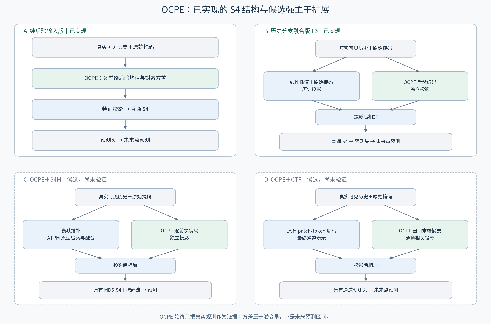

# OCPE：面向缺失模式变化的观测条件后验编码

**文档性质：方法说明与论文雏形。初稿：2026-11-20；本次修订：2026-11-23。**  
**英文名称：Observation-Conditioned Posterior Encoding，简称 OCPE。**  
**研究状态：OCPE＋普通 S4 的两轮实验已完成；接入 S4M、CTF 的方案仍处于设计阶段，本文不将其写成已有实验成果。**

## 摘要

多变量时间序列预测中的缺失问题，不只体现为观测数量减少。即使缺失率相同，散点缺失与连续块缺失也可能留下不同的信息：前者在时间上较分散，后者可能使关键时段整体不可见。训练阶段主要接触散点缺失的预测器，在测试阶段遇到连续块缺失时，可能无法沿用原来的信息利用方式。我们研究的是这一**历史输入缺失布局变化下的预测泛化问题**，当前以每变量 50% 缺失率下的 P↔B 双向错配为受控场景。

针对这个问题，本文整理一种观测条件后验编码方法 OCPE。其核心不是先补齐所有历史值，而是在可学习的线性高斯观测模型下，只根据真实可见位置和数值，计算窗口潜变量的后验均值及方差，再将其交给预测网络。直观地说，它先回答“现有证据支持怎样的潜在状态，以及还存在哪些约束不足”，再由预测主干学习未来变化。其统计计算来自既有线性高斯模型；后验矩输入神经网络也有直接先例。因此，当前应检验的贡献是这种条件编码在缺失错配预测中的实际价值，而非宣称提出了新的高斯后验理论。

我们已实现纯后验输入和保留历史分支的两种 OCPE＋S4 结构。第一轮在 Electricity、Weather 的部分错配条件下获得收益，但 ETTh1 未获整体改善；后续融合实验显示，简化的逐维归一化编码具有竞争力，完整后验求解没有普遍占优。现有证据支持继续研究显式观测条件编码，但尚不支持完整 OCPE 普遍优于其他缺失感知预测模型。本文进一步论证其接入 S4M、CTF 的条件与边界，并明确区分统计事实、设计假设和实验结论。

**关键词：**多变量时间序列预测；缺失模式变化；条件推断；线性高斯模型；后验编码；状态空间模型。

## 阅读导航

| 想先理解的问题 | 建议阅读 |
|---|---|
| 我们到底研究什么，思路怎么来的？ | 第 1—3 节 |
| “后验”是什么意思，具体怎么算？ | 第 4—6 节 |
| OCPE＋S4 的完整流程是什么？ | 第 7—8 节 |
| 为什么可能帮助 P↔B，而不是凭空猜测？ | 第 9 节 |
| 能否加到 S4M、CTF 上？ | 第 10—11 节 |
| 已有实验到底支持到哪一步？ | 第 12—13 节 |
| 论文可以主张什么，还缺什么？ | 第 14—15 节 |
| 代码、公式推导和引用如何核查？ | 附录 A—C、参考文献 |

本文采用编号引用，如 [[1]](#ref-1)。参考文献提供原文链接与具体阅读位置。**本文提出的解释性推导不等于已有论文对 OCPE 的性能证明；相关工作也不自动等于做过我们的 P↔B 协议。**

## 1. 研究问题：变化的是历史输入的可见方式

### 1.1 从实际采集变化到受控研究问题

在设备监测、能源负荷等场景中，设备故障、通信中断、采集策略调整，可能改变历史数据的可见方式。例如，训练时缺失主要是零散掉点，部署时却出现某个变量长时间没有观测。

我们希望研究：

> 当真实时序规律基本保持不变，而历史输入的缺失布局发生变化时，模型能否继续有效利用剩余观测，保持未来预测精度？

现实故障可能还与异常值、负荷状态或设备类型相关。当前人工实验先隔离其中一部分：**只改变缺失布局，不人为改变完整数据及未来目标的生成规律。** 这一设置便于判断性能变化是否与缺失布局有关，但不等于覆盖了所有真实故障。

### 1.2 任务定义

设历史窗口与未来目标分别为

$$
X\in\mathbb R^{L\times C},\qquad Y\in\mathbb R^{H\times C}.
$$

可见掩码为 $M\in\{0,1\}^{L\times C}$，其中 $M_{tc}=1$ 表示该位置可见。模型输入是可见数值及掩码，目标是输出未来点预测 $\widehat Y$。

记训练、测试的掩码分布分别为 $q_{\rm tr}(M)$、$q_{\rm te}(M)$。当前研究关注

$$
q_{\rm tr}(M)\ne q_{\rm te}(M),
$$

同时使用同一数据集的时间切分、相同预测任务和相同人工缺失率。人工掩码的抽样独立于样本数值；掩码内部的位置可以相关，因此“缺失与数值独立”不意味着“各位置独立缺失”。

当前主要设定为 $L=H=96$，每变量隐藏 48 个位置：

| 记号 | 含义 | 本研究中的用途 |
|---|---|---|
| P | 每变量随机选择 48 个散点 | 点缺失 |
| B | 每变量两个名义长度为 24 的连续缺口 | 块缺失；不同批次的具体位置规则见第 12 节 |
| P→P、B→B | 训练与测试使用同一家族 | 匹配条件 |
| P→B、B→P | 训练与测试使用不同家族 | 错配条件 |

当前通道之间独立抽样；我们尚未通过这套实验系统研究跨变量同步故障。**缺失率相同并不意味着信息量相同，也不意味着两种测试条件的理论最优误差必须相同。**

### 1.3 研究目标应如何表述

我们希望降低错配误差，同时保留匹配条件下的预测能力。只在错配条件变好、却使匹配误差明显增加，意味着存在精度与适应性的取舍，应单独报告。

一般缺失机制变化已经有理论与方法研究，例如 Robust prediction under missingness shifts [[7]](#ref-7)。因此，本研究不宜宣称“首次发现缺失分布会变化”。需要检验的是：**在多变量时序的 P↔B 场景中，如何构造有效的条件表示，以及它能否带来可重复的预测增益。**

## 2. 思路如何形成：从“补成什么值”转向“现有证据支持什么”

### 2.1 直接插补面临的问题

一种常见流程是“补齐历史→预测未来”。线性插值在短缺口中可能合理，但长缺口内部的曲线通常不能由相邻观测唯一确定。插值给出了一个确定的数值轨迹，却未同时表达这条轨迹还有多少不确定性。

这不意味着插值方法必然失败。若预测器同时获得掩码，且训练充分，它可以学会区别真实观测与插补值。**我们自己的 LI-S4 基线就接收插值结果和掩码，不能将其描述为完全不知道哪些值是补出来的。**

### 2.2 为什么想到低维潜在因素

在多变量序列中，多个位置可能受共同因素影响。例如，不同用户的负荷可能共同受工作日活动等因素影响。即使部分变量或时段缺失，其余观测仍可能帮助约束这些共同因素。

由此形成一个工作假设：与其要求模型先猜出所有缺失单元，不如先估计一个紧凑的窗口表示；不同可见位置对这一表示提供不同约束。这一想法属于既有潜变量建模路线，并非 OCPE 首创。因子分析与线性高斯模型提供了明确的数学基础 [[1]](#ref-1)、[[2]](#ref-2)。

当前的 16 维潜变量并没有预设物理含义，也没有保证每维都对应趋势、周期或某种设备状态。它是否形成有预测价值的共同因素，需要学习和验证。

### 2.3 为什么采用条件推断，而不只是普通投影

普通线性投影使用固定的映射。OCPE 则依据当前可见位置建立一个带先验约束的拟合问题：只使用实际观测，估计能够解释这些观测的潜在向量。

可见位置改变后，拟合问题也随之改变。由此得到的编码规则显式依赖当前证据，而不是仅依赖训练阶段常见的缺失形态。**这是我们希望用于缺失错配的主要归纳偏置。**

### 2.4 为什么再加入后验方差

相同的潜在估计值，可能来自充分证据，也可能来自证据不足时的先验回缩。只给出一个均值，未必能区分这两种情况。因此，我们把模型内的后验方差也作为输入特征。

这个接口有直接先例：GP-PoM 将高斯过程后验均值与逐点方差拼接后输入下游网络 [[3]](#ref-3)。它支持“将条件估计及其不确定性表示交给预测器”的设计，但其模型和任务不同，不能据此直接断言 OCPE 在缺失错配预测上有效。

### 2.5 原始设计来源与后续补充解释

最初实验计划明确列出的依据包括 PPCA、CRU，以及 S4 的官方实现；CRU 提供概率状态推断与神经时序模型结合的设计启发 [[1]](#ref-1)、[[5]](#ref-5)、[[8]](#ref-8)。后续核验补充了线性高斯综述、GP-PoM、NeuMiss 和缺失变化理论等相关工作。

**这些后续工作可以帮助检验和解释方案，但不能倒推成最初已经逐篇参考过的来源。** OCPE 是本课题对一个具体编码方案的命名，不代表该方案的全部统计组件都是新提出的。

## 3. 相关研究如何支撑本方法

| 文献方向 | 可以支持的具体观点 | 不能由此推出的结论 |
|---|---|---|
| 因子分析、PPCA、线性高斯综述 [[1]](#ref-1)、[[2]](#ref-2) | 低维潜变量解释观测依赖；高斯条件分布可以解析计算 | 我们学到的观测关系一定正确，或预测一定提高 |
| GP-PoM [[3]](#ref-3) | 后验均值与边缘方差可以作为下游网络输入 | 均值与方差拼接是 OCPE 首创；已解决 P↔B 预测 |
| RKN、CRU [[4]](#ref-4)、[[5]](#ref-5) | 显式概率推断可以与神经时序模型端到端结合 | 当前 OCPE 已具有动态 Kalman 转移或过程噪声 |
| NeuMiss [[6]](#ref-6) | 缺失预测的正确映射与可见子集有关，可以按计算结构共享参数 | 普通缺失感知网络不能近似条件推断 |
| 缺失变化理论、NeuMISE [[7]](#ref-7) | 可忽略缺失变化下，条件最优预测规则具有跨环境保持一致的条件 | OCPE 是唯一可行方法，或已获得有限样本泛化保证 |
| S4 [[8]](#ref-8) | 提供当前普通时序主干 | S4 本身提出了 OCPE 的概率观测模型 |
| S4M、CTF [[9]](#ref-9)、[[10]](#ref-10) | 提供已有缺失建模能力的强预测框架 | 两者已经按本研究协议验证了 OCPE，或接入后必然增益 |

NeuMiss 根据特定数据假设推导缺失条件下的最优预测形式，并将矩阵计算近似转化为网络结构 [[6]](#ref-6)。它提示我们：根据观测子集改变计算过程已有明确研究基础。本研究使用低秩潜空间求解及时间前缀表示，具体实现不同，但不应将“按掩码条件化”本身作为空白领域。

## 4. OCPE 的观测模型：哪些是参数，哪些是当前样本的估计

### 4.1 一段历史共享一个潜变量

对每个历史窗口设

$$
z\in\mathbb R^r,\qquad z\sim\mathcal N(0,I),\qquad r=16.
$$

观测模型为

$$
x_{tc}=\mu_c+a_{tc}^{\top}z+\epsilon_{tc},\qquad
\epsilon_{tc}\sim\mathcal N(0,v_c).
\tag{1}
$$

给定 $z$ 后，不同位置的观测残差被假设为相互独立。将历史展开为一个向量后，这对应具有对角残差协方差的线性高斯因子模型。PPCA 的标准形式还要求各位置噪声同方差，而本实现对不同变量学习不同残差尺度，因此称为“因子分析式观测模型”更准确 [[1]](#ref-1)。

### 4.2 训练参数与推理结果的区别

| 对象 | 含义 | 当前实现 |
|---|---|---|
| $A=\{a_{tc}\}$ | 各时间—变量位置对潜变量的载荷 | 形状为 $[96,C,16]$，训练学习 |
| $\mu_c$ | 变量基准 | 每变量一个可学习参数 |
| $v_c$ | 观测模型未解释部分的残差方差 | $\operatorname{softplus}(\rho_c)+0.01$ |
| $m_t$ | 当前窗口在前缀 $t$ 下的潜变量估计 | 根据当前可见观测计算 |
| $\Sigma_t$ | 当前窗口潜变量的模型内后验协方差 | 根据掩码与已学习参数计算 |

训练后，$A,\mu,v$ 固定；每个新样本的 $m_t,\Sigma_t$ 重新计算。**重新计算后验不是测试时重新训练，也不需要测试标签。**

载荷依赖历史中的相对位置和变量身份，不依赖当前样本动态生成。当前模块因此针对固定窗口长度和固定变量集合设计；换变量集合或顺序，需要相应适配，不能直接声称支持任意新增传感器。

$v_c$ 同时可能吸收真实噪声和低秩模型未解释的变化，不能直接等同于真实传感器噪声。

### 4.3 “后验”的准确含义

先验 $p(z)$ 表示尚未看当前窗口观测时对潜变量的假设；后验表示加入当前真实观测后的条件分布：

$$
p(z\mid X_{O_t},M),\qquad
O_t=\{(s,c):s\le t,\ M_{sc}=1\}.
$$

在当前与数值独立的人工缺失设置下，推断仅需按可见集合选取观测似然。**“后验”描述的是所设模型下的条件分布，不意味着所设模型已经被证明符合真实数据。**

这里的 $t$ 表示已经纳入多少历史证据。不同前缀估计的是同一个窗口潜变量；没有另行定义具有状态转移的动态 $z_t$。静态因子模型与动态状态空间模型的区别，可参见线性高斯综述 [[2]](#ref-2)。

## 5. 如何从可见观测计算编码

### 5.1 后验均值也是一个带先验的加权拟合解

在式（1）下，后验均值可以写成

$$
m_t=\arg\min_z\left[
\|z\|^2+
\sum_{(s,c)\in O_t}
\frac{(x_{sc}-\mu_c-a_{sc}^{\top}z)^2}{v_c}
\right].
\tag{2}
$$

直观解释是：寻找一个能够解释当前真实观测的潜在向量，同时避免证据不足时给出过大的估计。只有可见位置参与拟合；先验构成正则项；残差尺度决定观测的相对权重。

由于目标是正定二次函数，解唯一。在高斯设定下，这个解既是后验众数，也是后验均值。

### 5.2 信息形式与解析解

定义

$$
J_t=I+\sum_{(s,c)\in O_t}\frac{a_{sc}a_{sc}^{\top}}{v_c},
\qquad
b_t=\sum_{(s,c)\in O_t}\frac{a_{sc}(x_{sc}-\mu_c)}{v_c}.
\tag{3}
$$

则

$$
\Sigma_t=J_t^{-1},\qquad m_t=J_t^{-1}b_t,
\qquad p(z\mid X_{O_t},M)=\mathcal N(m_t,\Sigma_t).
\tag{4}
$$

$b_t$ 累积观测证据，$J_t$ 则描述这些位置对潜在方向的约束。附录 A 给出配平方推导；它是标准高斯条件计算在当前索引结构中的展开，不作为新的理论结果。

实际实现用 Cholesky 分解求解线性方程，并计算协方差。由于每个增量半正定且含有单位阵先验，$J_t$ 在数学上正定。正定性支持数值求解，但不等于统计模型正确或条件数总是理想。

### 5.3 编码为什么随掩码改变

对固定的可见集合，后验均值是观测数值的仿射变换；可见集合变化后，变换的系数也会变化：

$$
m_t=(I+A_{O_t}^{\top}D_{O_t}^{-1}A_{O_t})^{-1}
A_{O_t}^{\top}D_{O_t}^{-1}(X_{O_t}-\mu_{O_t}).
$$

所以 OCPE 不是单纯对填零数据应用固定投影。它根据当前可见布局重新构造拟合权重。但一个足够灵活的缺失感知网络原则上也可能近似这类映射；区别在于是否显式规定并执行这一计算。

### 5.4 两个观测为何不一定提供相同信息

考虑二维潜变量，先验协方差为 $I$，每个观测噪声方差为 1：

| 观测载荷 | 观测数量 | 后验协方差对角线 | 含义 |
|---|---:|---|---|
| $(1,0)$、$(0,1)$ | 2 | $(1/2,1/2)$ | 两个方向都受到约束 |
| $(1,0)$、$(1,0)$ | 2 | $(1/3,1)$ | 第一方向更明确，第二方向没有新证据 |

这个例子说明“位置覆盖的潜在方向”有意义。它**不能**证明 P 必然对应第一行、B 必然对应第二行。实际关系取决于学到的载荷与剩余观测。

如果载荷不随时间变化、每变量保留数量又相同，P 与 B 的最终精度矩阵甚至可能相同。因此不能预先断言块缺失的后验方差一定更大。

## 6. 方差表达什么，为什么可能有用

### 6.1 它表达观测约束，不直接识别异常

固定训练参数后，$J_t$ 不含观测数值，所以 $\Sigma_t$ 只由可见位置和观测模型参数决定：

| 改变条件 | 后验均值 | 后验协方差 |
|---|---|---|
| 掩码相同，观测数值变化 | 通常变化 | 不变 |
| 可见位置变化 | 可能变化 | 可能变化 |
| 整个时间步没有新观测 | 保持上一前缀结果 | 保持上一前缀结果 |
| 只缺一个变量，其他变量继续观测 | 可能更新 | 可能收缩 |

所以相同掩码下，剧烈波动与平稳窗口的后验方差相同。一个异常值可以改变均值，却不会因为“异常”而自动增大方差。

当观测集合逐步增加时，精度矩阵增加半正定项，协方差在半正定序下不增。这一性质针对**静态潜变量的信息累积**。它不能描述状态随时间变化而增加的过程不确定性。

### 6.2 方差为何可能影响点预测

以下为解释性数学例子，不是对真实数据的实验证明：

$$
z\mid O_1\sim\mathcal N(0,1),\qquad
z\mid O_2\sim\mathcal N(0,4).
$$

若 $Y=z^2$，两种情况下后验均值相同，但平方误差下的最优预测分别为 1 和 4。仅用均值无法区分，方差信息则可能有用。

相反，如果未来目标的条件均值严格线性，例如 $\mathbb E[Y\mid z]=Bz+d$，则

$$
\mathbb E[Y\mid X_O,O]=Bm_O+d.
$$

此时理想点预测未必需要显式方差。因此，“给网络方差”有合理动机，但不应预设其普遍必要。GP-PoM 的接口是相关先例，而不是针对我们场景的充分证明 [[3]](#ref-3)。

### 6.3 当前实际输入是边缘方差，不是完整后验

OCPE 输出

$$
u_t=\operatorname{Concat}\left(m_t,
\log\operatorname{diag}(\Sigma_t)\right)\in\mathbb R^{2r}.
\tag{5}
$$

“均值＋方差”表示特征拼接，不是将两者数值相加。均值求解使用完整精度矩阵；显式传给主干的方差只保留对角线。

完整高斯分布由均值和完整协方差决定。只保留对角线会丢失潜在方向之间的后验相关性，**不能据此宣称编码保留了完整条件分布或所有预测相关信息**。潜变量坐标也没有固定物理意义，对角方差不具有任意潜空间旋转下的不变性。

### 6.4 四种不确定性需要分开

| 对象 | 含义 | 当前状态 |
|---|---|---|
| $v_c$ | 观测模型残差尺度 | 训练学习，用于加权与似然 |
| $\Sigma_t$ | 潜变量的模型内后验协方差 | 对角线取对数后作为特征 |
| $a_{tc}^{\top}\Sigma a_{tc}+v_c$ | 历史位置的模型预测方差 | 用于事后隐藏历史诊断 |
| 未来 $Y$ 的预测分布 | 未来预测的不确定性 | 当前没有对应的概率输出模型 |

当前参数 $A,\mu,v$ 被视为已知，没有贝叶斯化全部网络参数。模型设定偏差、参数估计误差和新的噪声机制不在上述后验方差中。

此外，当前没有“方差大就自动降低某个分支权重”的强制机制，也没有后验采样、多情景预测或未来置信区间输出。网络是否以及如何使用方差，需要通过对照判断。

## 7. OCPE＋S4：两个已实现版本的完整流程



*图 1：上方为已实现的两种 OCPE＋S4 结构，下方为尚未实现验证的 S4M/CTF 接入位置。历史插值只属于历史分支，OCPE 分支始终读取原始真实观测与掩码。图中均为设计路径，不表示各方案均已获得性能优势。*

### 7.1 第一轮：纯后验输入版 OCPE-S4

```text
历史真实观测＋掩码
        ↓
可学习线性高斯观测模型
        ↓
每个前缀的后验均值＋后验对数方差
        ↓
特征投影 → 两层普通 S4 → 预测头
        ↓
未来 96 步点预测
```

这里没有原始历史旁路，也没有 S4M 的原型库。代码和早期实验 ID 中的 `PU-S4` 就是这个版本。

对单个样本，历史和掩码各为 $[96,C]$，后验均值为 $[96,16]$，内部协方差为 $[96,16,16]$，拼接特征为 $[96,32]$，投影后为 $[96,64]$，最终输出为 $[96,C]$。并非只把窗口末端一个向量送入 S4。

普通 S4 使用 DPLR 参数化：两层、宽度 64、状态维度 32、前馈宽度 128、dropout 为 0.1，其方法出处为 S4 [[8]](#ref-8)。S4 的状态演化发生在后端网络中，不应混同于 OCPE 观测模型具有动态潜变量转移。

### 7.2 第二轮：保留历史分支的融合版

```text
历史真实观测＋掩码
        ├─ 历史分支：线性插值 → 拼接原始掩码 → 历史投影 ─┐
        └─ OCPE分支：仅真实观测 → 条件编码 → 编码投影 ────┤
                                                        ↓
                                                     特征相加
                                                        ↓
                                              普通 S4 → 预测头
                                                        ↓
                                                   未来序列
```

完整 F3 版本为

$$
h_t=E_{\rm hist}([\widetilde X_t,M_t])+W_{\rm enc}u_t,
\qquad
\widehat Y=G_\phi(h_{1:L}).
\tag{6}
$$

历史分支保留曲线细节与缺失位置；后验分支提供另一种汇总真实观测的方式。其设计动机是减轻纯后验低维输入可能带来的信息压缩代价，但**此前实验没有证明压缩是失败的唯一原因，也没有证明增加历史分支就一定更好**。

$W_{\rm enc}$ 无偏置且零初始化。它为零时，预测函数可退化为相同历史分支与主干的基线；训练后是否仍有优势，不能由初始等价保证。

### 7.3 F0—F3 到底差在哪里

| 版本 | 额外条件分支特征 | 要检验的问题 |
|---|---|---|
| F0 | 无 | 常规历史＋掩码＋S4 的基线 |
| F1 | $[b_t/\operatorname{diag}(J_t),0]$，逐元素除法 | 简单逐维归一化是否已经足够？ |
| F2 | $[m_t,0]$ | 完整矩阵求解得到的均值是否更有用？ |
| F3 | $[m_t,\log\operatorname{diag}(\Sigma_t)]$ | 在均值之外提供方差有何增量？ |

F1 在编码分支中忽略潜在方向之间的非对角耦合，不是完整后验均值。F1/F2/F3 具有相同的观测参数结构、编码维度和辅助似然，但独立训练；比较反映整条表示路径及其学习结果，而不是固定同一套训练参数后只替换一个数值操作。

F1 的辅助似然仍需要末前缀的完整矩阵求解，不能将它描述成训练过程完全不使用完整求解。F0 没有观测模型及其辅助损失，因此增强版相对 F0 的增益也可能与新增容量和训练约束有关。

## 8. 训练目标、信息来源与计算实现

### 8.1 联合训练什么

对具有观测模型的版本，训练目标为

$$
\mathcal L=
\operatorname{MSE}_{\rm valid}(\widehat Y,Y)
+\lambda\frac{-\log p_\theta(X_O\mid M)}{\max(|O|,1)},
\qquad \lambda=0.1.
\tag{7}
$$

第一项学习未来预测；第二项将潜变量积分掉，约束观测模型解释可见历史。$\theta=(A,\mu,v)$ 与预测器参数共同通过梯度更新，因此最终观测参数既受历史似然约束，也受未来预测任务影响，不能将其称为仅由标准最大似然估计得到的参数。

归一化是为了控制不同观测数量的辅助损失尺度，不等于消除了不同布局的学习差异。当前 $0.1$ 是实验设置，不是理论推导出的最优系数。

### 8.2 哪些信息能够进入模型

| 信息 | 推理时使用？ | 说明 |
|---|---|---|
| 当前历史的真实可见数值 | 是 | 形成 $b_t$ 与历史分支输入 |
| 当前掩码、相对时间位置、变量身份 | 是 | 选取载荷和有效观测 |
| 训练学习的参数 | 是 | 规定观测关系和预测映射 |
| P/B 家族标签 | 否 | 不按人工家族切换专用模型 |
| 当前被隐藏的历史真值 | 否 | 只可用于隔离的事后诊断 |
| 当前未来真值 | 否 | 只在训练阶段作为合法预测标签 |
| 原型库、空间图 | 普通 S4 原型中没有 | S4M 扩展才涉及原型库 |

标准化使用训练段统计量。人工缺失框架从未施加人工掩码的有效训练源数据计算统计，这是共同预处理约定；它不等同于只能获取天然不完整训练数据的全部现实设置。Weather 的自然无效值修正见第 12 节。

**不能将插值或 S4M 的插补值当成真实观测送入 OCPE 似然。** 否则同一证据产生的猜测被当作额外观测，原来的条件推断解释不再成立，并可能低估模型内不确定性。

### 8.3 为什么采用小秩与 GPU 批量计算

设批量大小为 $N$。实现用批量矩阵乘法和前缀累加构建 $J_t,b_t$，再进行批量 Cholesky 分解，而不是逐样本调用 Python 循环求逆。后验矩阵仅为 $r\times r$，不构造 $LC\times LC$ 的完整观测协方差。

当前实现构造统计量的主要量级为 $O(NLCr^2)$，逐前缀分解约为 $O(NLr^3)$；保存前缀精度和协方差约需 $O(NLr^2)$。实现还存在与 $LCr^2$ 有关的共享中间量。因此，小秩有助于控制开销，但 OCPE 并非没有计算和显存代价，接入大主干后仍需实际测量。

## 9. 理论分析：为何与缺失错配有关，支持到哪一步

### 9.1 一个明确的条件推断解释

下面是针对本设计的条件性分析，不是新提出的统计定理。设：

1. 训练与测试共享同一潜变量、观测及目标生成规律；
2. 人工缺失与数值和目标独立，只改变可见集合的分布；
3. 观测模型能够正确描述数据；
4. $z$ 对预测足够，即给定 $z$ 后，$Y$ 不再依赖历史观测和掩码。

在这些条件下，

$$
p(Y\mid X_O,O)
=\int p(Y\mid z)\,p(z\mid X_O,O)\,dz.
\tag{8}
$$

这将任务分为“按当前证据推断状态”和“根据状态预测目标”。改变可见布局后，前一部分重新计算；后一部分仍对应相同的生成关系。

**该分析支持的设计动机是共享观测关系与推断规则，而不是把所有掩码强行映射成同一表示。** 式（8）需要完整后验才能作一般解释；当前对角方差编码和神经预测头并没有精确执行这个积分。

### 9.2 缺失变化理论带来的支撑与边界

Rockenschaub 等研究一般缺失机制变化，§4 的定理 1 讨论可忽略变化下 Bayes 预测规则的等价性 [[7]](#ref-7)。可直观理解为：在规定条件下，改变一种可见布局出现的频率，不必改变该布局下正确的条件预测关系。

这里“同一布局的规则跨环境保持一致”不意味着“P 和 B 的规则或最优误差相同”。论文中的一般机制、样本假设也不等于当前重叠时间窗口和 P/B 块布局。我们仅将其作为条件化研究方向的理论支撑，不将其改写为 OCPE 已有的有限样本泛化定理。

即使最优规则可以保持一致，训练数据中罕见的布局也可能没有被有效学习。P 的组合支持在数学上可能包含某些 B 掩码，不代表有限训练中真正见过足够多的长缺口。

### 9.3 当前理论无法保证的三件事

- **观测模型一定正确：**固定低秩线性模型可能无法表达突变、非线性和运行状态切换。
- **后验表示一定充分：**$z$ 可能遗漏未来相关细节，对角方差又进一步压缩了完整分布。
- **下游预测器一定泛化：**即使后验计算规则可用于新掩码，新掩码形成的表示也可能远离训练分布。

此外，如果缺失依赖未观测数值，例如异常高值更容易导致掉线，当前没有显式建模 $p(M\mid X,z)$ 的后验通常不再有同样的正确性解释。一般 MAR/MNAR 场景需要重新核查条件，不能把人工 MCAR 式实验直接推广过去。

### 9.4 “精确后验”与“准确预测”的区别

OCPE 的解析解是在给定参数与观测假设下精确。它不代表真实世界后验被精确恢复，也不代表未来预测达到 Bayes 最优。错误模型可以被精确求解，但结果仍可能错误。

同样，隐藏历史重建误差降低不必带来未来预测改善；辅助似然优化的方向与未来预测任务也可能冲突。这些问题应由对照分析，而非通过“后验”或“贝叶斯”名称排除。

## 10. 与普通缺失感知预测器相比，差别到底在哪里

### 10.1 两者都在从观测中推断未知信息

S4M、CTF 等模型本来就会根据可见历史预测未来。它们不需要写出显式后验公式，才算使用了观测条件信息。足够灵活的神经网络原则上也可能近似条件均值等计算。

OCPE 的区别在于**显式规定一种观测条件推断结构**：按可见位置构造 $J,b$，执行带先验的加权拟合，再向后续网络提供估计和约束程度。研究假设是：这种结构可能减少有限数据下学习复杂掩码条件映射的难度，而不是普通模型根本不能做这个事情。

### 10.2 它没有引入新观测，为什么仍可能有用

记原始可见输入为 $V=(X_O,M)$，OCPE 特征为 $T_\theta(V)$。固定训练参数后，它是输入的确定性函数，不会凭空增加原始数据的信息。

但主干的中间特征 $H(V)$ 可能已经压缩或忽略某些关系。此时 $T_\theta(V)$ 可能向后续网络补充 $H$ 没有保留的可用表示，或者提供更容易学习的计算结果。**增益可能来自归纳偏置、表示方式和优化过程，而不是新数据。**

若原主干已充分提取相关信息，OCPE 可能冗余；若其观测模型存在偏差，也可能引入干扰。这是接入强主干之前必须保留的判断。

### 10.3 为什么不直接用 OCPE 替换全部原有模块

早期纯后验版本已经显示匹配精度和数据集适用性的局限。因此，在更强的缺失感知模型上，先保留原有路径、添加独立编码分支，更便于检验额外价值。

这是一种研究设计选择，并非理论证明了相加融合最优。尤其当前简单融合在 Electricity 的反向错配中退化，不能把它当作已解决的结构问题。

## 11. 接入 S4M、CTF 的可行方案与条件

**本节属于候选扩展，尚无 OCPE＋S4M 或 OCPE＋CTF 的正式结果。**

### 11.1 S4M：保留检索与掩码路径，补充条件表示

S4M 的 ATPM 通过原型库检索并融合历史表示，MDS-S4 再联合处理表示与掩码。其方法见原论文 §3.2—3.3 [[9]](#ref-9)。本地实现还包含进入记忆模块前的衰减插补。

一个改动较小的候选流程是：

```text
真实历史＋掩码
    ├─ S4M原有分支：衰减插补 → ATPM检索融合 → c_t ─┐
    └─ OCPE分支：只取真实可见位置 → u_t → 投影 ────┤
                                                  ↓
                                                相加
                                                  ↓
                                  原有MDS-S4与掩码流 → 预测
```

$$
h_t=c_t+W_{\rm ocpe}u_t.
\tag{9}
$$

统计上的可能互补在于：原型分支使用经验模式匹配，OCPE 分支使用显式观测模型下的条件拟合。两条分支的结果都供后续网络利用，但后验方差不等于原型检索置信度。

此接法在 ATPM 之后，不改变检索查询和原型选择。**即使预测改善，也不能直接宣称修复了原型检索偏移。** 若要研究检索改进，需另行设计并验证，不属于当前接口已经具备的作用。

### 11.2 CTF：适配通道表示，保留注意力拓扑

CTF 使用局部 patch token 与通道 token，通过结构化注意力学习时序和跨通道交互；原论文 §4 说明完全缺失 patch 的屏蔽以及训练期随机 patch masking [[10]](#ref-10)。这已经是一种有针对性的缺失处理方式，不能将其描述为没有缺失适应能力。

一个便于控制改动范围的候选方案是，在最终通道表示送入预测头之前加入后验摘要：

$$
\widetilde g_c=g_c+P_cu_L,
\qquad \widehat Y=\operatorname{Head}(\widetilde g_1,\ldots,\widetilde g_C).
\tag{10}
$$

$g_c$ 为 CTF 的最终通道表示；$P_c$ 为通道相关的映射，可进一步采用共享映射与通道嵌入控制参数量。若每通道有多个 token，则还需明确映射的输出形状。只向每个通道重复同一个无通道区分的向量，未必能表达其不同作用。

这个候选方案仅使用末前缀摘要 $u_L$，与当前 S4 使用整个 $u_{1:L}$ 序列并不等价。若改为把前缀表示映射到 patch token，则还需要处理时间对齐、token 有效性和额外计算；目前没有依据认定哪种接口最好。

### 11.3 保留基线表达能力能说明什么

若附加映射为零，式（9）或式（10）可以退化为原主干。在不约束原参数、保持原计算路径的前提下，扩展模型的预测函数集合包含基线函数集合，因此理想全局优化下，其最小预测风险不会因函数集合扩大而变高。

这是一个简单的模型包含关系，**不是实际训练性能保证**。有限样本、优化过程、辅助损失及源验证选模，都可能使最终测试结果变差。零初始化也没有自动阻止负迁移的功能。

### 11.4 最小而有解释力的验证

| 比较 | 动机 |
|---|---|
| 原主干 vs 原主干＋F1 式简化编码 | 简单的观测信息归一化能提供多少增量？ |
| 原主干＋F1 vs 原主干＋完整 OCPE | 完整矩阵求解和方差是否值得保留？ |
| 必要时补充仅均值版本 | 若完整方案有效，再分辨方差增量 |

各模型应共享实际训练、验证和测试掩码，使用相同数据处理及可比训练预算；新增参数与辅助损失要明确报告。只有超过原主干，才能说模块有增量；还要超过简化编码，才能更有力地支持完整后验方案的必要性。

## 12. 已有实验：完成了什么，得到什么结论

### 12.1 第一轮：纯后验输入与普通 S4

第一轮完成 Electricity、Weather、ETTh1 共 36 次训练、216 项测试。对照为 LI-S4、STAT-S4 和完整 OCPE-S4；两个训练种子、两个测试掩码种子。主指标为标准化 MSE，详见[三数据集结果报告](1120-实验结果-OCPE-S4-三数据集-r50-2x2矩阵.md)。

| 数据集 | OCPE 相对 LI-S4：P→B | OCPE 相对 LI-S4：B→P | 匹配条件 | 判断 |
|---|---:|---:|---|---|
| Electricity | −47.4% | −16.0% | 两格约增加 14%—16% | 有错配收益，也有基础精度代价 |
| Weather | −26.9% | −11.1% | 两格约增加 1% | 旧预处理下的积极结果，需结合后续修正理解 |
| ETTh1 | +12.6% | +18.2% | 两格也退化 | 当前版本没有获得整体收益 |

负数表示误差降低，正数表示误差增加。STAT-S4 使用 $[b_t,\log\operatorname{diag}(J_t)]$，不是后续 F1 的逐维归一化；两者不能混写。STAT 与完整编码具有相同参数结构和辅助似然，但独立训练，因此第一轮不能单独识别方差的贡献。

隐藏历史诊断还显示：未来预测改善不一定对应更好的历史重建；Weather 标称 90% 历史区间覆盖率约为 98%—99%，提示区间过宽。它不支持“方差已可靠校准”，也不证明未来区间有效。

### 12.2 第二轮：保留历史分支，检验关键计算

第二轮完成 Weather、Electricity 上 F0—F3 共 32 次训练、128 项测试；ETTh1 与 S4M 增量确认未开展。详见[补充编码结果报告](1121-实验结果-OCPE补充编码与关键机制验证.md)。

| 数据集 | 版本相对 F0 | P→P | P→B_u | B_u→P | B_u→B_u |
|---|---|---:|---:|---:|---:|
| Weather | F1 简化编码 | −23.9% | −22.7% | −23.5% | −22.3% |
| Weather | F2 后验均值 | −19.5% | −18.0% | −23.2% | −21.5% |
| Weather | F3 均值＋方差 | −23.8% | −23.8% | −25.0% | −22.9% |
| Electricity | F1 简化编码 | −1.5% | −2.4% | −1.1% | +0.5% |
| Electricity | F2 后验均值 | −0.2% | −2.1% | +30.3% | +6.6% |
| Electricity | F3 均值＋方差 | −0.6% | −4.3% | +22.3% | +4.3% |

这里均为标准化 MSE 相对变化。**Electricity 的 +22.3% 表示 F3 比本轮 F0 的 B_u→P 误差更高，不是改善。**

结果支持以下判断：

1. Weather 上条件编码有预测价值，收益同时出现在匹配与错配条件，不能只归因于处理分布变化。
2. F2 相对 F1，在两个数据集的八个平均结果格中均未更好；当前没有完整矩阵求解普遍优于简单逐维归一化的证据。
3. F3 相对 F2 的八格标准化 MSE 均值均改善，但相对 F1 的优势有限，且不能消除 Electricity 反向错配退化。原量纲指标也不处处支持同样结论。
4. Electricity 上 F1 的 B_u→P 两个训练种子方向不一致，均值约 1% 的变化不能写成稳定收益。当前独立训练种子只有两个，不作统计显著性声明。

### 12.3 为什么两轮结果不能直接当成结构消融

| 差异 | 第一轮及更早基线 | 第二轮 | 影响 |
|---|---|---|---|
| 结构 | 第一轮 OCPE 为纯后验输入 | 保留历史分支再融合 | 不是同一个预测结构 |
| B 位置规则 | 更早基线的块可能相接；第一轮 OCPE 块分离但位置集中 | $B_u$ 从 1176 种合法分离块组合中等概率抽样 | 同样写作 B，不代表实际掩码一致 |
| Weather 有效值 | 第一轮训练统计纳入 81 个 `-9999` 占位值 | 将其标为无效，排除统计、似然和标签损失 | 标准化尺度和损失加权改变 |

$B_u$ 的“均匀”指合法位置组合等概率，不表示各时刻缺失边际概率完全相同。P 掩码沿用兼容规则，但这不能使不同 B 定义自动可比。

因此，不能把第二轮数字变化全部归因于“加入历史分支”，也不能把第一轮 Weather 的结论当作已在清理后完全复现。可靠比较应优先使用每轮内部共享实际掩码的对照。

## 13. 与历史强基线相比，当前竞争力如何

下面仅整理 Electricity 的历史原量纲 MSE，单位为百万，越低越好。它帮助认识性能差距，**不构成统一协议下的公平排名**。

| 方法 | B 协议 | P→P | P→B | B→P | B→B |
|---|---|---:|---:|---:|---:|
| S4M | 旧块协议，可相接 | 7.224 | 8.070 | 7.538 | 7.389 |
| CTF | 旧块协议，可相接 | 7.792 | 8.862 | 15.591 | 6.295 |
| 线性插值＋iTransformer | 旧块协议，可相接 | 5.122 | 44.090 | 19.038 | 4.918 |
| 线性插值＋PatchTST | 旧块协议，可相接 | 5.788 | 22.409 | 25.396 | 5.649 |
| 第一轮纯后验 OCPE-S4 | 分离但位置集中 | 8.270 | 15.596 | 13.771 | 8.551 |
| 第二轮 F3 融合版 | $B_u$ | 7.757 | 26.746 | 12.534 | 8.605 |

基线来源为[1113 统一框架报告](../1113-实验结果-统一框架-r50-2x2矩阵.md)，两个 OCPE 版本来源为第 12 节的两份结果报告。表中数值为原量纲，不能与标准化 MSE 混在一起计算变化比例。

这些记录没有显示 OCPE 已经全面超过强基线：S4M 的四格 MSE 均低于两个 OCPE 版本；早期 OCPE 在两个错配方向均低于两种插值模型，但 F3 的 P→B 已高于 PatchTST。两个 OCPE 的 B→P MSE 低于 CTF，但其原量纲 MAE 分别为 420.153、449.990，高于 CTF 的 400.006，不能作无条件的优劣概括。

当前更准确的定位是：**显式条件编码具有局部经验价值，但尚未证明优于已有缺失感知强模型。** 这也是将其作为附加模块进行检验的动机，不能把“换到强主干上可能更好”当成已经成立的结果。

## 14. 如果形成论文，贡献应如何组织

### 14.1 目前能够成立的研究叙述

可以围绕以下逻辑组织论文：

> 在历史输入缺失布局变化时，预测器面临的不只是缺失数量增加，而是可用证据的覆盖方式改变。我们研究显式观测条件编码能否帮助预测网络利用这些证据，以可学习线性高斯模型的条件估计为具体实现，并通过完整编码、简化编码及缺失感知主干对照，检验其作用与适用范围。

这比“提出一个均值＋方差模块，理论上更鲁棒”更准确，也更接近可验证的研究问题。

### 14.2 不宜写成已成立贡献的内容

| 表述 | 原因 |
|---|---|
| 首次提出根据观测子集进行条件推断 | 既有统计方法、NeuMiss 等已有相关计算 |
| 首次将后验均值与方差输入网络 | GP-PoM 等已有先例 |
| 从理论上保证 P↔B 泛化 | 当前只有条件性动机，没有针对已训练系统的泛化界 |
| 后验方差直接给出未来置信度 | 当前没有未来概率输出，也没有相应校准证据 |
| 完整求解优于简化编码 | 第二轮结果不支持普遍成立 |
| 已验证增强 S4M、CTF | 接入实验尚未开展 |
| 对所有设备故障与 MNAR 有效 | 当前独立人工掩码不覆盖这些条件 |

### 14.3 最值得进一步检验的命题

1. **整体价值：**在统一掩码下，条件编码能否增强已有缺失感知强主干，而不只是弱基线？
2. **计算必要性：**若有增益，来自简单观测归一化，还是完整后验条件化与方差？
3. **问题针对性：**收益是否在长块、特定观测覆盖不足条件下更明显，还是一般容量与正则化收益？
4. **代价与适用范围：**能否保留匹配精度，增益是否足以抵消参数、显存与时间开销？

如果简化编码稳定更优，应当据实收缩方法，研究其为什么有效；不应为了保留“后验”叙述而忽略反证。若完整方案在强主干上没有稳定增益，也需要重新评估其作为论文核心方法的可行性。

## 15. 阶段性结论

OCPE 可以准确地定义为：

> 建立在可学习线性高斯观测模型上的潜在编码模块。它按当前真实可见位置构建条件拟合问题，计算窗口潜变量的后验均值与模型内方差，并将这些量作为下游预测器的输入特征。

它的统计基础清楚，作为附加编码分支接入 S4、S4M 或 CTF 在结构上可行。其可能的价值在于显式执行观测条件计算，帮助有限训练数据下的预测器组织证据；这一价值不是由新增数据或概率术语保证的。

已有实验说明该方向存在有效场景，也暴露了完整求解、精度保持和跨数据集适用性的限制。当前应把 OCPE 作为**有统计依据、已有局部经验支持、仍需强基线确认的候选方法**，而不是已经完成论证的通用缺失错配解决方案。

## 附录 A：后验推导与辅助似然

### A.1 从观测模型到后验

令 $r_O=X_O-\mu_O$，$A_O$ 为可见位置的载荷矩阵，$D_O=\operatorname{diag}(v_i:i\in O)$。由先验与观测似然：

$$
\log p(z\mid X_O,O)
=-\frac12z^\top z
-\frac12(r_O-A_Oz)^\top D_O^{-1}(r_O-A_Oz)+\mathrm{const}.
$$

整理得

$$
\log p(z\mid X_O,O)
=-\frac12z^\top Jz+b^\top z+\mathrm{const},
\quad J=I+A_O^\top D_O^{-1}A_O,
\quad b=A_O^\top D_O^{-1}r_O.
$$

配平方可得

$$
-\frac12(z-J^{-1}b)^\top J(z-J^{-1}b)+\mathrm{const}.
$$

因此均值为 $J^{-1}b$，协方差为 $J^{-1}$。正定二次项也说明式（2）的解唯一。这些都是标准高斯代数的应用 [[1]](#ref-1)、[[2]](#ref-2)。

### A.2 边缘似然如何只用可见历史计算

将 $z$ 积分掉，有

$$
X_O\sim\mathcal N(\mu_O,C_O),\qquad C_O=D_O+A_OA_O^\top.
$$

利用矩阵行列式引理与 Woodbury 恒等式，可以写成

$$
-2\log p(X_O\mid O)
=|O|\log(2\pi)+\log|D_O|+\log|J|
+r_O^\top D_O^{-1}r_O-b^\top J^{-1}b.
$$

这就是代码使用低秩矩阵计算观测 NLL 的依据。只对可见位置求和，不需要人工隐藏历史的真值；再按观测数归一化，得到式（7）的辅助项。

### A.3 为什么边缘方差不足以代表完整后验

两个高斯分布可以有相同均值和相同协方差对角线，却有不同的非对角项。对于 $Y=z_1z_2$，

$$
\mathbb E[Y\mid X_O,O]=m_1m_2+\Sigma_{12}.
$$

若仅保留 $m$ 和 $\operatorname{diag}(\Sigma)$，一般无法恢复 $\Sigma_{12}$。这说明当前输出接口是对完整后验的特征化选择，不能套用“完整后验充分”的论证来保证其没有信息损失。

## 附录 B：实现、实验与阅读入口

| 材料 | 入口 | 说明 |
|---|---|---|
| 第一轮模型 | [posterior_s4.py](../../exp/models/posterior_s4.py) | `GaussianObservation`、`PosteriorS4` |
| 第二轮模型 | [ocpe_fusion_s4.py](../../exp/models/ocpe_fusion_s4.py) | `ConditionalEncoder`、`FusionS4` |
| 第一轮训练 | [run_posterior_s4.py](../../exp/scripts/run_posterior_s4.py) | 未来损失与辅助观测似然 |
| 第二轮训练 | [run_ocpe_fusion_s4.py](../../exp/scripts/run_ocpe_fusion_s4.py) | 历史保留与 F0—F3 对照 |
| S4M 本地模型 | [S4M.py](../../exp/baselines/S4M/s4m/model/S4M.py) | 核对插补、记忆模块与 MDS-S4 位置 |
| CTF 本地模型 | [ChannelTokenFormer_missing.py](../../exp/baselines/ChannelTokenFormer/models/ChannelTokenFormer_missing.py) | 核对 token 编码、通道表示与预测头 |
| 原始计划 | [1119 实验计划](1119-实验计划-观测条件后验推断与轻量S4验证.md) | 设计来源与第一轮预设协议 |
| 第一轮报告 | [三数据集结果](1120-实验结果-OCPE-S4-三数据集-r50-2x2矩阵.md) | 第一轮结果及诊断 |
| 第二轮报告 | [补充编码结果](1121-实验结果-OCPE补充编码与关键机制验证.md) | F0—F3、数据修正和掩码审计 |
| 专属文献资料 | [方法依据与相近工作](literature_sources/1120_ocpe_method_foundations/README.md) | 原文、阅读位置和历史来源区分 |

模型和训练文件是已运行实验的证据，本次文档修订没有修改它们。原模型文件中的实现 ID 保留，不能把新接口设想写成已存在功能。

## 附录 C：引用核查与工具说明

本次以既有资料包和一手论文原文为依据，补充核查 GP-PoM、缺失变化理论、S4M 与 CTF 的对应段落；没有声称完成穷尽查新，也没有将某论文在别的缺失条件下有效推断为已验证本研究协议。编号引用只支撑其对应陈述，其他数学例子与接口设计由本文单独说明。

| 编号 | 推荐核查位置 | 在本文中的证据用途 |
|---|---|---|
| [1] | §2.1、§3.1 式（6）、§4.1 | 因子分析、PPCA 区别与条件推断基础 |
| [2] | 推断讨论、静态因子模型与动态模型部分 | 静态窗口与动态状态的区别 |
| [3] | §4，式（6）—（8）；§6 | 均值＋边缘方差输入下游网络的直接先例 |
| [4] | §2 方法 | 概率状态更新与神经网络联合学习 |
| [5] | §3，尤其连续—离散滤波部分 | 动态概率时序模型的设计先例 |
| [6] | §2.2、§3 | 缺失条件预测与可微计算结构 |
| [7] | §3—4、定理 1；§5.1 | 缺失变化的条件理论和 NeuMISE |
| [8] | §2—3 | 普通 S4 主干来源 |
| [9] | §3.2—3.3 | ATPM、MDS-S4 及其接口 |
| [10] | §4 的 patch masking 与注意力部分 | CTF 的已有缺失处理和通道表示 |

本次沿用 [literature-review 技能](/home/wangzk/.codex/skills/literature-review/SKILL.md) 的来源分层与引用核验方式。工具来源另列为 Kassis 等（2026），*Scientific Agent Skills: A Library of Procedural Knowledge for Research Agents*，[arXiv:2609.00065](https://arxiv.org/abs/2609.00065)，不作为 OCPE 的方法理论来源。其建议的 AI 图示脚本因缺少 `OPENROUTER_API_KEY` 未能执行；图 1 改用可复现的 Matplotlib 绘制，生成代码见 [build_architecture.py](assets/1123_ocpe_method/build_architecture.py)，不是 AI 生成图。

## 参考文献

<a id="ref-1"></a>
**[1]** Tipping, M. E., & Bishop, C. M. (1999). Probabilistic principal component analysis. *Journal of the Royal Statistical Society: Series B*, **61**(3), 611–622. DOI: [10.1111/1467-9868.00196](https://doi.org/10.1111/1467-9868.00196). [作者论文 PDF](https://www.cs.columbia.edu/~blei/seminar/2020-representation/readings/TippingBishop1999.pdf)。

<a id="ref-2"></a>
**[2]** Roweis, S. T., & Ghahramani, Z. (1999). A unifying review of linear Gaussian models. *Neural Computation*, **11**(2), 305–345. DOI: [10.1162/089976699300016674](https://doi.org/10.1162/089976699300016674). [作者论文 PDF](https://cs.nyu.edu/home/people/in_memoriam/roweis/papers/NC110201.pdf)。

<a id="ref-3"></a>
**[3]** Moor, M., Horn, M., Bock, C., Borgwardt, K., & Rieck, B. (2020). Path imputation strategies for signature models. *arXiv:2005.12359*. 本文核对 v1，2020-05-25；其中方法名为 GP-PoM。[原文 §4](https://arxiv.org/html/2005.12359v1#S4)。

<a id="ref-4"></a>
**[4]** Becker, P., Pandya, H., Gebhardt, G., Zhao, C., Taylor, C. J., & Neumann, G. (2019). Recurrent Kalman networks: Factorized inference in high-dimensional deep feature spaces. *Proceedings of ICML*, PMLR **97**, 544–552. [正式论文入口](https://proceedings.mlr.press/v97/becker19a.html)。

<a id="ref-5"></a>
**[5]** Schirmer, M., Eltayeb, M., Lessmann, S., & Rudolph, M. (2022). Modeling irregular time series with continuous recurrent units. *Proceedings of ICML*, PMLR **162**, 19388–19405. [正式论文入口](https://proceedings.mlr.press/v162/schirmer22a.html)。

<a id="ref-6"></a>
**[6]** Le Morvan, M., Josse, J., Moreau, T., Scornet, E., & Varoquaux, G. (2020). NeuMiss networks: Differentiable programming for supervised learning with missing values. *Advances in Neural Information Processing Systems*, **33**. [正式论文入口](https://proceedings.neurips.cc/paper/2020/hash/42ae1544956fbe6e09242e6cd752444c-Abstract.html)。

<a id="ref-7"></a>
**[7]** Rockenschaub, P., Xian, Z., Zamanian, A., Piperno, M., Ciora, O.-A., Pachl, E., & Ahmidi, N. (2024). Robust prediction under missingness shifts. *arXiv:2406.16484*. 本文按 2024 年 v1 引用，其中 §5.1 提出 NeuMISE；不据此认定后续正式发表信息。[原文](https://arxiv.org/html/2406.16484v1)。

<a id="ref-8"></a>
**[8]** Gu, A., Goel, K., & Ré, C. (2022). Efficiently modeling long sequences with structured state spaces. *International Conference on Learning Representations*. 2021 年 arXiv 首发。[论文入口](https://arxiv.org/abs/2111.00396)。

<a id="ref-9"></a>
**[9]** Peng, J., Yang, M., Zhang, Q., & Li, X. (2025). S4M: S4 for multivariate time series forecasting with missing values. *International Conference on Learning Representations*. [正式论文 PDF](https://proceedings.iclr.cc/paper_files/paper/2025/file/7b2f0758334389b8ad0665a9bd165463-Paper-Conference.pdf)；[可检索原文](https://arxiv.org/html/2503.00900v1)。

<a id="ref-10"></a>
**[10]** Jang, J., Park, H., Choi, J., & Kim, T. (2025). Towards robust real-world multivariate time series forecasting: A unified framework for dependency, asynchrony, and missingness. *arXiv:2506.08660*. 方法名 ChannelTokenFormer；本文依据 2025-06-10 的 v1 说明其结构，年份为该文稿年份。[原文](https://arxiv.org/html/2506.08660v1)。
