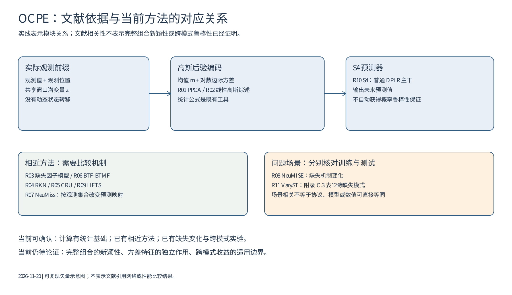

# OCPE 方法依据、相近工作与当前创新边界

日期：2026-11-20。对象：当前已实现和实验的 OCPE-S4。本文是定向范围调研，不是穷尽式系统综述；不提供已排除全部重复工作的结论。

## 1. 先回答：我们的方法参考了什么

当前原型可以拆成三步：用低秩概率模型描述历史窗口；根据实际观测前缀计算潜变量后验；把后验均值与对数边际方差序列交给 S4 做预测。

其中，线性高斯潜变量和后验计算有经典统计基础，概率状态估计与神经时序模型的组合也已有研究。当前需要查证的是具体编码结构、适用问题及其有效性解释，而不能把“后验均值加方差”本身宣称为新概念。

能从原实验计划附录 B 确认的外部依据是 PPCA、CRU 和 S4 官方实现。本轮将 S4 的论文补齐，并补充或重新核验其他相近工作。后来找到的论文应写成相关工作，不能倒推成最初设计来源。

| 层次 | 主要文献 | 可以支持的表述 | 不能据此推出 |
|---|---|---|---|
| 统计模型与解析推断 | R01 PPCA；R02 线性高斯综述 | 当前前端属于有明确假设的线性高斯因子模型 | 高斯后验更新是我们的新推导 |
| 任意观测子集与低秩缺失预测 | R03 Bańbura–Modugno；R06 BTF/BTMF | 根据剩余观测做因子推断、用于预测已有先例 | 任意缺失处理就是跨缺失机制鲁棒 |
| 不确定性与神经时序模型 | R04 RKN；R05 CRU；R09 LIFTS | 潜状态、概率推断和神经预测有成熟研究 | 将不确定性接入预测网络就是新颖性 |
| 缺失条件预测与机制变化 | R07 NeuMiss；R08 NeuMISE | 观测集合影响预测映射；变化下稳定性依赖条件 | 当前训练出的 OCPE 已满足相关一致性定理 |
| 实际跨缺失模式时空预测 | R11 VaryST | 跨散点/块缺失已有可定位的实验 | 我们当前协议与其完全相同，或可直接比较论文数字 |
| 序列主干 | R10 S4 | 普通 S4 的出处与高效实现 | 主干自带对缺失错配的概率保证 |

详细元数据与原文入口见[参考文献表](references.csv)，逐篇对照见[阅读笔记](reading_notes.md)。

## 2. 当前代码究竟属于哪一种统计模型

这部分是对当前实现的数学归纳，不把它冒充为某篇论文原封不动提出的算法。

一个历史窗口共享一个潜变量 z。历史值通过时间位置和通道对应的载荷生成：

\[
z\sim\mathcal N(0,I),\qquad x_{t,c}=\mu_c+a_{t,c}^{\mathsf T}z+\epsilon_{t,c},\qquad \epsilon_{t,c}\sim\mathcal N(0,v_c).
\]

固定模型参数，对前缀中实际观测的索引集合 O_t 进行条件推断：

\[
J_t=I+\sum_{(s,c)\in O_t}\frac{a_{s,c}a_{s,c}^{\mathsf T}}{v_c},\qquad
b_t=\sum_{(s,c)\in O_t}\frac{a_{s,c}(x_{s,c}-\mu_c)}{v_c}.
\]

\[
\Sigma_t=J_t^{-1},\qquad m_t=J_t^{-1}b_t,\qquad h_t=[m_t,\log\operatorname{diag}(\Sigma_t)].
\]

这些后验公式可以通过将高斯先验与观测似然相乘、对 z 的二次型配方得到；不是新增的统计定理。PPCA §2.1 讨论因子分析，§3.1 式(6)给出其各向同性特例的潜变量条件分布。当前 v_c 随通道变化，因此更准确的称呼是因子分析式线性高斯模型，而非严格的原始 PPCA。[R01 原文](https://www.cs.columbia.edu/~blei/seminar/2020-representation/readings/TippingBishop1999.pdf)

当前 z 没有 z_t→z_(t+1) 的状态转移。不同 t 表示对同一个窗口潜变量积累了不同前缀观测，不能等同于动态 Kalman 滤波。线性高斯综述 §5.1 对静态因子模型与动态模型的区分有助于说明这一点。[R02 原文](https://cs.nyu.edu/home/people/in_memoriam/roweis/papers/NC110201.pdf)

还应保留三个边界：

1. 当前实验中的掩码由外部随机机制生成。若缺失本身含有额外的潜状态信息，忽略掩码生成过程未必能给出正确后验；当前公式不自动覆盖 MNAR。
2. 固定参数和观测集合时，Σ_t 不依赖这条样本的观测数值。它不会仅因为出现异常值就自动增大；没有新观测时，也没有动态过程噪声使它随间隔扩大。
3. 网络只接收协方差对角线，而非完整协方差。不能声称下游 S4 得到了完整高斯后验分布或未来预测区间。

与代码的详细对应见[OCPE 方法说明](../../1120-方法说明-OCPE观测条件后验编码.md)。

## 3. 相近方法已经做到什么

### 3.1 从实际观测推断低维因子，并非空白

Bańbura–Modugno 研究具有任意缺失模式的动态因子模型估计，采用 EM 及相应状态估计处理不完整数据。其 2010 工作论文、2012 在线期刊版本和 2014 正式卷期应分开记录。它支持“缺失因子建模有统计先例”，不直接支持我们针对 P↔B 的效果主张。[R03 期刊](https://onlinelibrary.wiley.com/doi/10.1002/jae.2306)、[2010 工作论文](https://www.ecb.europa.eu/pub/pdf/scpwps/ecbwp1189.pdf)

BTF 将低秩分解和 VAR 时间先验结合，BTMF 是其矩阵版本。其 §4.2 给出根据观测条目进行的条件采样，§4.3 讨论预测实现；采用 Gibbs 推断。与 OCPE 的主要差别涉及时间先验、学习与推断方式，以及是否把解析后验特征交给独立神经主干。不能只把区别写成“我们用了潜变量、对方没有”。[R06 作者原文](https://lijunsun.github.io/files/papers/2021-TPAMI-BTMF.pdf)

### 3.2 显式不确定性与神经网络结合，也已有先例

RKN 用学习到的高维隐表示及因子化协方差实现可微 Kalman 推断。CRU 则以线性 SDE 描述状态演化，利用连续—离散滤波处理不规则观测。这两者均说明：均值、协方差和神经时序预测的组合不是新概念。当前静态窗口结构只是与它们不同；“不同”还需进一步转化成有价值的任务适配或效果优势。[R04](https://proceedings.mlr.press/v97/becker19a.html)、[R05](https://proceedings.mlr.press/v162/schirmer22a.html)

LIFTS 是另一项需要重点比较的潜变量时序工作。其一般框架是非线性状态空间模型，联合考虑测量与观测掩码，采用可学习的前向过滤、后向平滑和 energy-score 训练。其线性高斯特例不能代表整个模型，也不能据此说它与当前 OCPE 的闭式前端相同。本轮确认其相关性，尚未据此建立优劣结论。[R09 原文 §2–6](https://arxiv.org/html/2610.03916v2)

### 3.3 按观测集合改变预测映射，已有直接理论讨论

NeuMiss 在高斯数据及特定缺失机制下推导预测形式，并通过 Neumann 级数近似构造共享参数的网络。因此，“不同观测集合需要不同条件映射”应写成问题动机与已有事实。当前 OCPE 在低秩潜空间求解，而 NeuMiss 的构造侧重原始特征协方差相关映射；需要比较计算量、假设和泛化表现，而不能只比较术语。[R07 原文 §2–3](https://proceedings.neurips.cc/paper/2020/hash/42ae1544956fbe6e09242e6cd752444c-Abstract.html)

## 4. 哪些论文确实研究了缺失机制变化

### 4.1 NeuMISE：问题直接相关，但实验不是我们的时序块协议

Robust prediction under missingness shifts 的 §3–4 明确定义 source/target 缺失机制变化并分析条件预测器，§5.1 提出 NeuMISE。其方法改变缺失维度的迭代嵌入方式，并不是简单引用 NeuMiss 作为唯一方法。[R08 原文](https://arxiv.org/html/2406.16484v1)

该论文适合支撑“这是一个已有明确研究的问题”和“鲁棒性要说明条件”。但其已核验场景是一般特征缺失，涉及机制和缺失率等变化，不能写成已经完成了与我们相同的时间块 P↔B 实验。理论中还需考虑数据生成关系、可忽略性、可观测模式支持及估计一致性等条件，不能把条件预测器稳定直接替换成任意有限样本神经模型稳定。

### 4.2 VaryST：确有跨模式实验，必须在相关工作中承认

其附录 C.3 表12明确报告 PEMS04 与 PEMS08、30% 缺失下 RM→CM 和 CM→RM。RM 是散点缺失，CM 是时空块缺失。这是实际训练—测试跨模式证据，而不只是同模型在若干缺失率下分别重训。[R11 附录 C.3](https://arxiv.org/html/2610.19813v1#A3.SS3)

不过，VaryST 的主要目标更广，包括时空分布、空间域与观测可用性变化；其方法重点是基于长历史构造表示、动态支持节点检索和 IGOP。它不是 OCPE 后验前端的设计来源。

| 比较项 | 当前 OCPE-S4 | VaryST 已核验设置 |
|---|---|---|
| 主任务数据 | Electricity、Weather、ETTh1 | 跨缺失模式表使用 PEMS04、PEMS08 |
| 历史与预测长度 | L=96、H=96 | 交通实验历史 2016 步、预测 12 步 |
| 块缺失 | 每通道两个分离 B24 块，合计缺失 48/96 | 论文称为时空块 CM，需按其生成器核对 |
| 训练扰动 | 当前 source P 或 B；固定协议训练 | 使用额外 IGOP 历史 patch 扰动 |
| 缺失率 | 主实验 50% | 表12为 30% |
| 评价 | 当前统一预测指标 | 附录说明按其 observed positions 计算；需要适配时明确掩码位置 |

因此应承认已有跨模式实验，同时通过统一数据、掩码、可用历史、目标和训练增强协议进行比较。当前数值不足以声称已超过 VaryST。

## 5. 当前可以怎样表述贡献

可以把当前工作描述为：**构建并验证一种基于实际观测前缀的低秩后验编码，将估计状态与模型条件方差作为神经预测器的输入，并研究其在时间缺失形态变化下的行为。** 这是一项待进一步确立贡献的研究原型描述。

目前不宜写成以下结论：首次使用后验均值与方差；首次以实际观测做概率推断；首次研究缺失机制变化；已证明 OCPE 在 P↔B 下鲁棒；没有其他模型做过同类流程。

| 待论证主张 | 已有证据 | 仍缺什么 |
|---|---|---|
| 高斯计算有数学基础 | 标准模型与后验公式；当前代码可对应 | 不缺一项新“后验定理”，缺与任务假设的严密连接 |
| 具体组合有独立价值 | 已有原型及三数据集对照 | 与相近机制的统一协议比较；代价与适用条件 |
| 方差特征解释了提升 | 当前完整版本结果及诊断 | 均值单独输入、方差信息作用等有辨别力的机制验证 |
| 对跨模式变化有效 | Electricity、Weather 的部分错配有收益；ETTh1 失败 | 更充分的模型、训练种子和变化范围；不能抹去失败条件 |
| 新颖性充分 | 已核验本表 11 篇的相应部分 | 更完整的相似方法排查及实现级比较 |

以上“仍缺什么”用于记录证据缺口，不视为用户已确认的新实验计划。当前结果详见[三数据集报告](../../1120-实验结果-OCPE-S4-三数据集-r50-2x2矩阵.md)。

## 6. 检索与核验的实际完成范围

本轮使用 web 学术检索、arXiv API、Crossref 元数据与正式会议/作者原文，另尝试 DBLP。DBLP API 返回验证页，不能当作成功检索；原始内容与失败状态均保留。技能建议的 parallel-cli 未安装，使用 web 工具替代。

arXiv 定向检索返回的其他缺失机制变化文献，以及关键词检索出现的其他潜变量模型，记录为候选而不是一律宣布无关。本轮的 11 篇是围绕当前原型选择的阅读集，不是由全量数据库筛选得到的最终纳入集。

书目信息核验与方法核验分开：DOI 可以解析不等于方法结论已核实；能下载 PDF 也不等于已经全文精读。R03 的期刊版本和工作论文版本、R06 的 early-access 与正式卷期差异，均写入主表。详细过程见[检索日志](search_log.json)与[核验记录](citation_verification.json)。

本轮未完成穷尽搜索、双人筛选、所有补充材料及官方代码审计，也未复现文献结果。因此，本资料包能够作为可追溯的研究依据和下一轮比较清单，不能替代论文投稿前的完整查新。

## 7. 文件与引用

研究文献见[文献主表](references.json)及[BibTeX](references.bib)；[逐篇笔记](reading_notes.md)提供章节定位。

文献整理使用的技能与工具来源单独列在[工具与复现说明](tooling_and_reproducibility.md)，不作为 OCPE 模型的理论依据。
