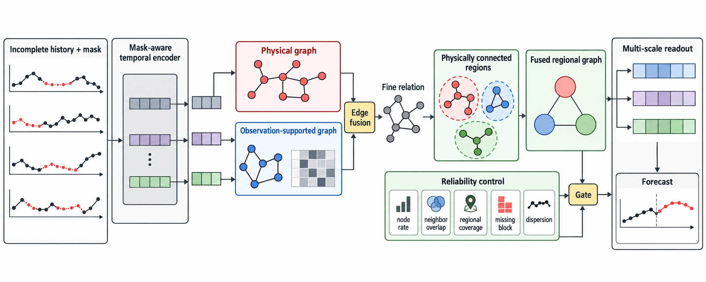

# 基于缺失可靠关系学习的空间时间序列区域图预测

## 摘要

空间时间序列中的缺失观测不仅会缩短时间上下文，也会使学习得到的传感器关系变得不可靠。本文提出 **MR-MSGF**，直接从不完整历史预测未来值，而不设置单独监督的历史插补阶段。MR-MSGF 构造窗口特定的关系图，并用成对共同观测对学习到的节点相似度进行正则化；随后将该关系图与物理拓扑融合，再将融合关系粗化为物理连通区域。轻量级可靠性门控进一步决定区域上下文何时影响多尺度预测。在 METR-LA 上，MR-MSGF 在连续块缺失和点状缺失下获得方向一致、配对显著的 MAE 降幅；AQI36 自然缺失和 Block-T 70% 下的 RMSE 则进一步表明，该机制是一种缺失感知归纳偏置，而非跨数据集的性能保证。

**关键词：** 多变量时间序列预测，缺失观测，时空图学习，图粗化

## 1. 引言

交通、环境和工业传感器网络预测同时依赖时间上下文与传感器间关系。时空图模型通常以物理拓扑或学习到的邻接矩阵表征这些关系 \cite{dcrnn,mtgnn}，混合模型则结合物理关系与数据驱动关系 \cite{stfgnn}。两类关系都用于在传感器间传播信息；在非同步故障下，数值相似的两个节点表示可能建立在完全不同数量的共同观测之上。因此，缺失不仅影响节点历史，也影响一条推断边是否具有足够证据用于消息传播。

缺失数据研究主要处理节点历史问题。插补方法通过双向循环模型 \cite{brits}、面向不规则采样的时间注意力 \cite{mtan} 或图传播 \cite{grin,spin} 重构数值；直接预测则联合编码数值与掩码 \cite{crib,coifnet}。这些路线使不完整历史可用于预测；但当特征进入图学习时，节点可用性本身并不能说明一个候选节点对有多少共同历史支撑。

成对证据不同于节点级缺失指示。较大的自适应相似度既可能由极少数恰好同时观测的样本估计，也可能由很长的共同观测历史支撑；数值强度属于同一类量，但其证据量不同。在 top-$k$ 选择将候选关系提交给后续图传播之前，这一区分尤为重要。

不规则观测下的关系建模也已在预测之外得到研究。RAINDROP 从不规则观测中学习样本级传感器图以完成分类 \cite{raindrop}；TGNN4I 则以连续时间图状态处理部分节点观测和不规则时间 \cite{tgnn4i}。在缺失数据预测中，BiTGraph 将缺失模式偏置注入时间与图传播 \cite{bitgraph}，GinAR 在变量缺失下结合预定义图与自适应图 \cite{ginar}，GCN-M 则研究不完整交通观测下的图学习 \cite{gcnm}。这些工作将缺失与节点表征或图构造联合建模，但并未显式区分学习关系的强度与支撑该关系的成对证据量。

多尺度模型进一步在时间和空间上聚合上下文 \cite{hdtts,pguts,higp}。物理拓扑提供不依赖当前缺失窗口的稳定局部先验，学习图则可刻画窗口特定的功能依赖；两者互补，但任一来源都不能单独决定粗粒度区域消息是否对特定节点有用。即使物理连通，区域仍可能覆盖稀疏、存在长缺失段，或节点表征明显偏离区域中心。先融合两类关系再进行物理连通区域化，可使区域聚合保留两种证据；再以节点、边和区域级线索条件控制区域上下文，便可避免将粗粒度聚合视作始终有益。

这引出一个具体问题：给定不完整历史，模型如何判断一条学习边及其诱导的区域消息是否可信？本文将**关系可靠性**作为与历史重构互补的问题来研究。目标不是恢复一个真实图或校准不确定性，而是让预测消息依赖可获得的证据。MR-MSGF 通过共同观测正则化学习关系，在物理连通区域化前与物理拓扑融合，并用节点、边和区域级可靠性证据门控区域上下文，从而回答该问题。

本文贡献如下：

1. 用成对共同观测正则化学习边，再进行稀疏选择，以量化**关系可靠性**。
2. 融合观测支持图和物理图，对融合关系区域化，并以可靠性证据门控区域消息和多尺度读出。
3. 配对 METR-LA 实验支撑该偏置，AQI36 与极高缺失条件界定其适用范围。

## 2. 方法

### 2.1 问题设置与基础骨架

令 $X\in\mathbb{R}^{T\times N\times C}$ 表示历史窗口，$M\in\{0,1\}^{T\times N\times C}$ 表示观测掩码，$A^{\mathrm{phy}}\in\mathbb{R}^{N\times N}$ 表示物理邻接矩阵。模型从 $X^{\mathrm{obs}}=M\odot X$、$M$ 与 $A^{\mathrm{phy}}$ 预测 $Y\in\mathbb{R}^{H\times N\times C_y}$。关系图和可靠性统计量均按窗口计算，省略 batch 下标。记通道平均掩码为 $\bar M_{t,i}=C^{-1}\sum_cM_{t,i,c}$，并定义

$$
r_i=\frac{1}{T}\sum_t\bar M_{t,i},\qquad
q_{ij}=\frac{1}{T}\sum_t\bar M_{t,i}\bar M_{t,j}.
$$

其中 $r_i$ 表示节点可用性，$q_{ij}$ 表示共同观测率，全文使用行归一化。缺失感知时间编码器首先将不完整历史映射为层级化节点状态 $H_\ell\in\mathbb{R}^{N\times d}$ 与多分辨率空间状态 $B_{s,\ell}$。其中 $\ell$ 表示时间层级，$s=0$ 表示最细空间层级，$s>0$ 表示更粗的空间层级。MR-MSGF 通过关系融合与区域传播细化最细层状态，而更粗层状态为多尺度读出提供互补上下文。

图 1 概括完整预测路径：共同观测证据首先调节细粒度关系学习，融合后的关系随后被区域化，可靠性证据再选择性地将区域上下文注入多尺度预测。

**图 1：** MR-MSGF 总览。缺失感知编码器从不完整历史形成时间状态；共同观测支持图先与物理图融合，再进行物理连通区域粗化；可靠性证据调节区域残差注入和多尺度读出。

### 2.2 观测支持关系融合

编码器产生历史特征 $E\in\mathbb{R}^{T\times N\times d}$。本文用掩码池化得到窗口特定节点表示：

$$
u_i=\frac{\sum_t\bar M_{t,i}E_{t,i}}{\sum_t\bar M_{t,i}+\epsilon}.
$$

观测支持分数结合学习相似度与共同观测证据：

$$
s_{ij}=\frac{(W_qu_i)^\top(W_ku_j)}{\sqrt d},
$$

$$
\tilde{s}_{ij}=s_{ij}+\operatorname{softplus}(\beta)\log(q_{ij}+\epsilon).
$$

其中 $\beta$ 是可学习标量。对每个节点保留 top-$k$ 分数，经过行 softmax、自环添加和行归一化得到有向稀疏图 $A^{\mathrm{obs}}$，实验中 $k=8$。对数项在稀疏化前软抑制共同观测很少的边。

物理图归一化为 $\bar A^{\mathrm{phy}}=\operatorname{RowNorm}(A^{\mathrm{phy}}+I)$。随后使用可学习边门控形成细粒度关系：

$$
g_{ij}=\sigma\!\left(\psi_g([r_i,r_j,q_{ij},\bar A^{\mathrm{phy}}_{ij},A^{\mathrm{obs}}_{ij}])\right),
$$

$$
A^{\mathrm{fine}}=\operatorname{RowNorm}\!\left(g\odot\bar A^{\mathrm{phy}}+(1-g)\odot A^{\mathrm{obs}}\right).
$$

因此，物理结构和观测支持关系都参与端到端学习的关系融合。该门控是边级的，而不是全局混合系数，使物理和观测支持证据能够在不同边上获得不同权重。实现中 $\psi_g$ 为一个 $5\!\rightarrow\!16\!\rightarrow\!1$ 的两层 MLP，中间使用 GELU 激活。

### 2.3 可靠性控制的区域上下文

本文仅根据物理图构造固定硬分配 $S\in\{0,1\}^{N\times K}$，每个节点属于一个区域。对称化物理邻接矩阵并移除自环后，按剩余物理度选种子，再贪心加入与区域成员具有最大正亲和力的未分配节点，直至无候选节点或达到 $m=8$。该过程保证区域物理连通且不吸收零亲和力节点。令 $n_k=\sum_iS_{ik}$，则

$$
Z^{\mathrm{fine}}_{\ell}=\operatorname{ELU}(A^{\mathrm{fine}}H_{\ell}W_f+H_{\ell}W_s),
$$

$$
H^{\mathrm{reg}}_{\ell,k}=\frac{1}{n_k}\sum_iS_{ik}Z^{\mathrm{fine}}_{\ell,i},
$$

$$
A^{\mathrm{coarse}}=\operatorname{RowNorm}(S^\top A^{\mathrm{fine}}S).
$$

区域传播和提升为

$$
Z^{\mathrm{reg}}_{\ell}=\operatorname{ELU}(A^{\mathrm{coarse}}H^{\mathrm{reg}}_{\ell}W_c+H^{\mathrm{reg}}_{\ell}W_r),
$$

$$
Z^{\mathrm{coarse}}_{\ell}=SZ^{\mathrm{reg}}_{\ell}.
$$

在细粒度融合之后再进行区域粗化，使区域聚合操作作用于同时包含物理结构和观测支持关系的图；仅从物理图或仅从观测图粗化均无法保留这两类关系证据。

对于节点 $i$，记 $\bar q_i=\sum_j\bar A^{\mathrm{phy}}_{ij}q_{ij}$ 为物理支持加权的共同观测率，$\rho_i=\sum_kS_{ik}n_k^{-1}\sum_jS_{jk}r_j$ 为区域覆盖率，$b_i$ 为当前历史窗口中最长连续缺失段占 $T$ 的比例。令 $k(i)$ 为节点 $i$ 所在区域，$c_{i,\ell}=H^{\mathrm{reg}}_{\ell,k(i)}$，并定义

$$
\zeta_{i,\ell}=\sqrt{\max\!\left(d^{-1}\lVert Z^{\mathrm{fine}}_{\ell,i}-c_{i,\ell}\rVert_2^2,\epsilon\right)},\qquad
\delta_{i,\ell}=\frac{\zeta_{i,\ell}}{N^{-1}\sum_j\zeta_{j,\ell}+\epsilon}.
$$

这里 $\delta_{i,\ell}$ 是相对区域中心的归一化表征离散度。区域门控为

$$
\alpha_{i,\ell}=\sigma\big(\psi_\alpha([r_i,\bar q_i,\rho_i,b_i,\delta_{i,\ell}])
+\gamma^\top[1-r_i,1-\bar q_i,\rho_i-1,b_i,-\delta_{i,\ell}]\big).
$$

其中 $\psi_\alpha$ 与边门控具有相同的两层 MLP 结构，$\gamma$ 是可学习缩放向量。第二项用于将缺失模式及区域一致性作为额外残差信号输入门控；由于 $\gamma$ 不施加符号约束，本文不将其解释为具有单调方向保证的先验。令 $\boldsymbol{\alpha}_{\ell}=[\alpha_{1,\ell},\ldots,\alpha_{N,\ell}]^\top\in\mathbb{R}^N$，并将其沿特征维广播，最细空间表示更新为

$$
\widetilde B_{0,\ell}=Z^{\mathrm{fine}}_{\ell}+\boldsymbol{\alpha}_{\ell}\odot\big(Z^{\mathrm{coarse}}_{\ell}W_p\big),
$$

而 $s>0$ 时 $\widetilde B_{s,\ell}=B_{s,\ell}$。读出阶段进一步加入可靠性偏置。记 $R_i=[r_i,\bar q_i,\rho_i,b_i]^\top$，则第 $h$ 个预测步对多尺度状态的打分为

$$
e_{h,s,\ell,i}=e^{\mathrm{repr}}_{h,s,\ell,i}+w_{s,\ell}^\top R_i.
$$

对每个节点和预测步，在所有 $(s,\ell)$ 上执行 softmax 得到 $\pi_{h,s,\ell,i}$，并计算 $F_{h,i}=\sum_{s,\ell}\pi_{h,s,\ell,i}\widetilde B_{s,\ell,i}$；预测头将 $F_{h,i}$ 映射为 $\hat Y_{h,i}$。因此，可靠性统计量只偏置各尺度的选择分数，不直接替代表示内容。

训练目标为掩码预测 MAE：

$$
\mathcal{L}_{\mathrm{pred}}=\frac{\sum M^Y\odot|\hat Y-Y|}{\sum M^Y},
$$

其中 $M^Y$ 排除不可评估的未来目标。当前模型不使用重构、图或聚类辅助损失。
区域门控不被解释为校准不确定性，而是一个面向预测的控制变量，用于判断某个节点在某个时间层级是否应引入区域上下文。这样可以保持新增分支轻量，同时避免无条件区域传播造成过平滑。

## 3. 实验

### 3.1 设置

实验使用 METR-LA 交通速度与 AQI36 空气质量数据，以 24 步历史预测未来 12 步。METR-LA 的 Point 和 Block-T 掩码仅作用于历史，未来目标在有效、未遮蔽原始值上评估；前者模拟独立缺失，后者模拟连续故障。AQI36 保留自然有效性掩码并可叠加 Point 掩码。每个条件使用五个配对掩码种子和相同输入掩码，仅以掩码预测损失训练。固定 $k=m=8$，以 $\beta=1$ 和全 1 的 $\gamma$ 初始化，在 METR-LA 与 AQI36 上分别得到 $K=31$、$K=5$ 个连通区域。主要基线为 HD-TTS-AMP；BiTGraph 使用统一的数据、掩码和评估接口。

### 3.2 主结果

表 1 给出 METR-LA 结果。MR-MSGF 在所有测试的 Block-T 和 Point 缺失设置下均相对 HD-TTS-AMP 降低 MAE；在 Block-T 30%/50% 和 Point 30%/50% 下也降低 RMSE。在 Block-T 70% 极高缺失条件下，MR-MSGF 仍降低 MAE，但 RMSE 略高，说明该设置下收益并非跨指标一致。五个条件下，MR-MSGF 的五次配对 MAE 运行均胜出，双侧配对 $t$ 检验均满足 $p\leq0.0379$；本文不对 RMSE 作跨条件的显著性结论。

| 缺失模式 | 缺失率 | 方法 | MAE | RMSE |
|---|---:|---|---:|---:|
| Block-T | 30% | HD-TTS-AMP | $3.2281 \pm 0.0108$ | $6.6036 \pm 0.0126$ |
| Block-T | 30% | BiTGraph | $3.8232 \pm 0.0110$ | $7.8839 \pm 0.0373$ |
| Block-T | 30% | MR-MSGF | **$3.1997 \pm 0.0159$** | **$6.5840 \pm 0.0485$** |
| Block-T | 50% | HD-TTS-AMP | $3.3546 \pm 0.0126$ | $6.8780 \pm 0.0215$ |
| Block-T | 50% | BiTGraph | $3.9729 \pm 0.0180$ | $8.1905 \pm 0.0458$ |
| Block-T | 50% | MR-MSGF | **$3.3079 \pm 0.0195$** | **$6.8154 \pm 0.0554$** |
| Block-T | 70% | HD-TTS-AMP | $3.4650 \pm 0.0103$ | **$7.0927 \pm 0.0421$** |
| Block-T | 70% | BiTGraph | $4.1363 \pm 0.0132$ | $8.4812 \pm 0.0306$ |
| Block-T | 70% | MR-MSGF | **$3.4458 \pm 0.0102$** | $7.1088 \pm 0.0384$ |
| Point | 30% | HD-TTS-AMP | $3.1048 \pm 0.0074$ | $6.3592 \pm 0.0154$ |
| Point | 30% | BiTGraph | $3.6374 \pm 0.0124$ | $7.5260 \pm 0.0377$ |
| Point | 30% | MR-MSGF | **$3.0764 \pm 0.0118$** | **$6.3091 \pm 0.0447$** |
| Point | 50% | HD-TTS-AMP | $3.1598 \pm 0.0112$ | $6.4755 \pm 0.0215$ |
| Point | 50% | BiTGraph | $3.6938 \pm 0.0049$ | $7.6577 \pm 0.0289$ |
| Point | 50% | MR-MSGF | **$3.1409 \pm 0.0068$** | **$6.4564 \pm 0.0289$** |

**表 1：** METR-LA 五个配对掩码种子的主结果。越低越好。

### 3.3 跨域与预测跨度分析

AQI36 作为带有自然缺失的跨域压力测试。表 2 显示，MR-MSGF 在自然缺失条件下弱于 HD-TTS-AMP；在额外 Point 25% 缺失时同时降低 MAE 和 RMSE；在额外 Point 50% 缺失时降低 MAE 但提高 RMSE。异构自然缺失并不一定让当前可靠性统计量与可迁移关系对齐；这只是由结果提示的假设，而非因果解释。因此，AQI36 被视为该方法的边界条件，而非跨数据集稳定增益的证据。

| 条件 | 方法 | MAE | RMSE |
|---|---|---:|---:|
| 自然缺失 | HD-TTS-AMP | **$30.4839 \pm 0.5849$** | **$49.3332 \pm 1.4069$** |
| 自然缺失 | MR-MSGF | $30.7269 \pm 0.2392$ | $49.8879 \pm 0.9287$ |
| 自然缺失 + Point 25% | HD-TTS-AMP | $31.2034 \pm 0.6894$ | $50.3712 \pm 1.0346$ |
| 自然缺失 + Point 25% | MR-MSGF | **$31.1169 \pm 0.4161$** | **$50.3325 \pm 0.7815$** |
| 自然缺失 + Point 50% | HD-TTS-AMP | $31.7359 \pm 0.4956$ | **$50.4029 \pm 1.2035$** |
| 自然缺失 + Point 50% | MR-MSGF | **$31.6451 \pm 0.7093$** | $50.5270 \pm 1.3859$ |

**表 2：** AQI36 跨域结果，五个随机种子。

本文还按预测跨度分解 METR-LA Block-T checkpoint。50% 缺失下，MR-MSGF 在第 3、6、12 步同时降低 MAE 和 RMSE；70% 缺失下，MR-MSGF 在三个预测步均略微降低 MAE，但三个预测步的 RMSE 均升高。这与主表整体结果一致，说明极高缺失率下的收益主要体现在平均误差，而不是大误差控制。

| 缺失率 | 预测步 | HD-TTS-AMP MAE/RMSE | MR-MSGF MAE/RMSE |
|---:|---:|---:|---:|
| 50% | 3 | $3.1319/6.2557$ | **3.0750**/**6.1586** |
| 50% | 6 | $3.3787/6.9274$ | **3.3333**/**6.8715** |
| 50% | 12 | $3.6532/7.6045$ | **3.6195**/**7.5840** |
| 70% | 3 | $3.2773$/ **$6.5703$** | **$3.2520$** / $6.5811$ |
| 70% | 6 | $3.4777$/ **$7.1235$** | **$3.4667$** / $7.1568$ |
| 70% | 12 | $3.7302$/ **$7.7343$** | **$3.7186$** / $7.7618$ |

**表 3：** METR-LA Block-T 预测跨度分解。

### 3.4 消融与诊断

表 4 分解 METR-LA Block-T 50% 缺失下的机制。完整模型在 MAE 和 RMSE 上均最优。移除共同观测打分惩罚、可靠性门控或读出偏置都会降低性能；仅使用物理图或仅使用观测图也弱于融合图。这支持本文的核心设计：共同观测引导的关系融合与可靠性控制的区域上下文具有互补作用。

| 变体 | MAE | RMSE |
|---|---:|---:|
| HD-TTS-AMP | $3.3546 \pm 0.0126$ | $6.8780 \pm 0.0215$ |
| 仅物理图 | $3.3292 \pm 0.0118$ | $6.8605 \pm 0.0490$ |
| 仅观测图 | $3.3348 \pm 0.0161$ | $6.8874 \pm 0.0587$ |
| 融合图 | $3.3176 \pm 0.0111$ | $6.8288 \pm 0.0455$ |
| 去除 $q_{ij}$ 打分惩罚 | $3.3149 \pm 0.0200$ | $6.8327 \pm 0.0547$ |
| 无可靠性门控 | $3.3136 \pm 0.0105$ | $6.8395 \pm 0.0420$ |
| 无读出偏置 | $3.3298 \pm 0.0249$ | $6.8512 \pm 0.0375$ |
| 完整 MR-MSGF | **$3.3079 \pm 0.0195$** | **$6.8154 \pm 0.0554$** |

**表 4：** METR-LA Block-T 50% 消融，五个配对掩码种子。

## 4. 结论

MR-MSGF 通过让学习到的图关系依赖共同观测证据，再与物理关系融合并用可靠性证据门控区域上下文，从不完整空间历史中进行预测。METR-LA 的配对结果支持关系可靠性是一种有用的缺失感知归纳偏置；Block-T 70% 的混合 RMSE 结果和 AQI36 自然缺失结果则限定了这一结论：该机制并非跨数据集、跨指标无条件成立的性能保证。

## 参考文献

文内引用键及完整条目与正式稿使用同一参考文献库：[references.bib](references.bib)。
