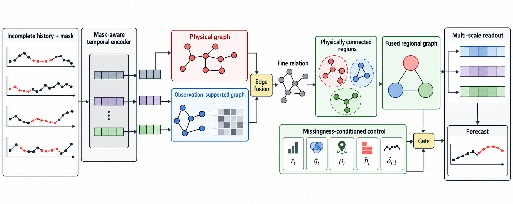

# 面向缺失时空序列的双关系区域多尺度图预测

## 摘要

空间监测序列预测同时依赖节点历史和传感器间关系。传感器间的非同步缺失带来两项相互关联的挑战：它既缩短单个节点的可用历史，也减少图消息传递中推断传感器关系所需的成对共同观测。现有缺失预测方法主要通过插补或节点级掩码处理不完整历史，却未显式考察学习关系是否由充分的成对观测支持。为此，本文提出双关系区域多尺度图预测（Dual-Relation Regional Multi-Scale Graph Forecasting, DRR-MSGF），一个直接从不完整时空历史预测未来值的图预测框架。DRR-MSGF 在稀疏选择前利用成对共同观测正则化窗口特定的学习关系分数，将所得关系图与物理拓扑融合，并在物理连通区域内聚合区域上下文；随后利用缺失模式和区域特征，对区域消息注入进行门控，并偏置多尺度读出。相比图模型基线 HD-TTS-AMP，DRR-MSGF 在 METR-LA 交通速度数据的五种测试设置中均降低 MAE；在 AQI36 空气质量数据上叠加较高比例的 Point 缺失时也取得更低的 MAE。

**关键词：** 多变量时间序列预测，缺失观测，时空图学习，图粗化

## 1. 引言

交通、环境和工业传感器网络预测同时依赖时间上下文与传感器间关系。时空图模型通常以物理拓扑或学习到的邻接矩阵表征这些关系 \cite{dcrnn,mtgnn}，混合模型则结合物理关系与数据驱动关系 \cite{stfgnn}。两类关系都用于在传感器间传播信息。在传感器以非同步方式发生缺失时，看似相似的两个节点表征可能建立在数量差异显著的共同观测之上。因此，缺失不仅影响节点历史，也影响一条推断边是否具有足够证据用于消息传播。

缺失数据研究主要处理节点历史问题。插补方法通过双向循环模型 \cite{brits}、面向不规则采样的时间注意力 \cite{mtan} 或图传播 \cite{grin,spin} 重构数值；直接预测则联合编码数值与掩码 \cite{crib,coifnet}。这些路线使不完整历史可用于预测；但当特征进入图学习时，节点可用性本身并不能说明一个候选节点对有多少共同历史支撑。

成对证据不能由节点级缺失指示替代。相近的自适应相似度既可能仅由少量偶然同时观测的样本估计，也可能由较长的共同观测历史支撑；相似度反映数值亲近性，却不反映支撑该关系的证据量。在 top-$k$ 选择将候选关系提交给后续图传播之前，这一区分尤为重要。

不规则观测下的关系建模也已在预测之外得到研究。RAINDROP 从不规则观测中学习样本级传感器图以完成分类 \cite{raindrop}；TGNN4I 则以连续时间图状态处理部分节点观测和不规则时间 \cite{tgnn4i}。在缺失数据预测中，BiTGraph 将缺失模式偏置注入时间与图传播 \cite{bitgraph}，GinAR 在变量缺失下结合预定义图与自适应图 \cite{ginar}，GCN-M 则研究不完整交通观测下的图学习 \cite{gcnm}。据我们所知，上述方法虽将缺失与节点表征或图构造联合建模，却未将成对共同观测量作为学习关系的显式支持，并在稀疏选择前据此调节候选边。

多尺度模型进一步在时间和空间上聚合上下文 \cite{hdtts,pguts,higp}。物理拓扑提供不依赖当前缺失窗口的稳定局部先验，学习图则可刻画窗口特定的功能依赖；两者互补，但任一来源都不能单独决定粗粒度区域消息是否对特定节点有用。即使物理连通，区域仍可能覆盖稀疏、存在长缺失段，或节点表征明显偏离区域中心。将两类关系融合后，再在由物理图定义的连通区域内聚合融合图，可使区域上下文保留两类关系证据；再以节点、观测和区域级线索条件化地控制区域上下文，便可避免将粗粒度聚合视作始终有益。

这引出一个具体问题：给定不完整历史窗口，模型如何依据可获得的观测支持来调节学习边传播及其诱导的区域消息？目标不是恢复一个真实图或校准不确定性，而是让预测消息依赖可获得的证据。DRR-MSGF 通过共同观测正则化学习关系，将其与物理拓扑融合，并在物理连通区域内聚合融合图；随后以观测与区域特征条件化地控制区域上下文，从而回答该问题。

本文贡献如下：

1. 提出面向不完整历史的观测图--物理图关系融合：从掩码感知表征构造窗口特定观测图，以成对共同观测在稀疏选择前调节候选边，再与物理拓扑逐边融合。
2. 提出先融合、后区域化的建模方式：在固定物理连通区域内聚合融合图，构造同时保留两类关系来源的区域上下文。
3. 提出观测与区域条件化的区域上下文控制：调节区域消息注入强度，并偏置多尺度读出。

## 2. 方法

### 2.1 问题设置与基础骨架

令 $X\in\mathbb{R}^{T\times N\times C}$ 表示历史窗口，$M\in\{0,1\}^{T\times N\times C}$ 表示观测掩码，$A^{\mathrm{phy}}\in\mathbb{R}^{N\times N}$ 表示物理邻接矩阵。模型将 $X^{\mathrm{obs}}=M\odot X$、$M$ 与 $A^{\mathrm{phy}}$ 映射为预测 $\hat Y\in\mathbb{R}^{H\times N\times C_y}$，以估计同形状的未来目标 $Y$。关系图和观测特征均按窗口计算，省略 batch 下标。本文全部数据集均为每节点一个目标通道（$C=C_y=1$），因此 $\bar M_{t,i}=M_{t,i,1}$，并定义

$$
r_i=\frac{1}{T}\sum_t\bar M_{t,i},\qquad
q_{ij}=\frac{1}{T}\sum_t\bar M_{t,i}\bar M_{t,j}.
$$

其中 $r_i$ 表示节点可用性，$q_{ij}$ 表示节点对共同观测支持，$\epsilon>0$ 防止除零和 $\log 0$；仅消息传播邻接矩阵使用行归一化。本文保留 HD-TTS-AMP \cite{hdtts} 的缺失感知编码器、膨胀时间层级、固定物理空间层级和读出模块。该骨架将不完整历史映射为层级化节点状态 $H_\ell\in\mathbb{R}^{N\times d}$ 与多分辨率空间状态 $B_{s,\ell}$，其中 $\ell$ 表示时间层级，$s=0$ 表示最细空间层级。DRR-MSGF 仅以 $\widetilde B_{0,\ell}$ 替换 $B_{0,\ell}$；$s>0$ 的状态保持为多尺度读出的互补上下文。所有 $W_q,W_k,W_f,W_s,W_c,W_r,W_p\in\mathbb{R}^{d\times d}$，而 $w_{s,\ell}\in\mathbb{R}^{4}$。

图 1 概括完整预测路径：共同观测证据调节细粒度关系学习；融合图在物理区域上聚合，缺失模式条件化特征控制区域上下文。

**图 1：** DRR-MSGF 总览。缺失感知编码器从不完整历史形成时间状态；融合图在仅由物理图定义的连通区域上聚合；观测与区域特征调节区域注入和多尺度读出。

### 2.2 观测支持关系融合

编码器产生历史特征 $E\in\mathbb{R}^{T\times N\times d}$。本文用掩码池化得到窗口特定节点表示：

$$
u_i=\frac{\sum_t\bar M_{t,i}E_{t,i}}{\sum_t\bar M_{t,i}+\epsilon}.
$$

观测支持分数结合学习相似度与共同观测证据：

$$
s_{ij}=\frac{(W_qu_i)^\top(W_ku_j)}{\sqrt d},
$$

$$
\tilde{s}_{ij}=s_{ij}+\operatorname{softplus}(\beta)\log(q_{ij}+\epsilon).
$$

其中 $\beta$ 是可学习标量。对每个有向得分行保留 top-$k$ 条目（$k=8$），再经行 softmax、加入单位阵贡献并行归一化得到稀疏图 $A^{\mathrm{obs}}$。被选中的对角得分是学习边，附加单位阵是唯一固定自环。若 $r_i=0$，令 $A^{\mathrm{obs}}_{i,:}=0$，避免 top-$k$ 并列产生任意边。对数项在稀疏化前软抑制支持不足的边。

物理图归一化为 $\bar A^{\mathrm{phy}}=\operatorname{RowNorm}(A^{\mathrm{phy}}+I)$。随后使用可学习边门控形成细粒度关系：

$$
g_{ij}=\sigma\!\left(\psi_g([r_i,r_j,q_{ij},\bar A^{\mathrm{phy}}_{ij},A^{\mathrm{obs}}_{ij}])\right),
$$

$$
A^{\mathrm{fine}}=\operatorname{RowNorm}\!\left(g\odot\bar A^{\mathrm{phy}}+(1-g)\odot A^{\mathrm{obs}}\right).
$$

在式 (6) 后，若 $r_i=0$，则以 $\bar A^{\mathrm{phy}}_{i,:}$ 覆盖 $A^{\mathrm{fine}}_{i,:}$。

因此，物理结构和观测支持关系都参与端到端学习的关系融合。该门控是边级的，而不是全局混合系数，使物理和观测支持证据能够在不同边上获得不同权重。实现中 $\psi_g$ 为一个 $5\!\rightarrow\!16\!\rightarrow\!1$ 的两层 MLP，中间使用 GELU 激活。

### 2.3 缺失模式条件化的区域上下文

本文仅根据物理图构造固定硬分配 $S\in\{0,1\}^{N\times K}$，每个节点唯一分配至一个区域。METR-LA 使用阈值为 $0.1$ 的距离连通图；AQI36 使用站点间 Haversine 高斯权重 $\exp[-(d_{ij}/\sigma)^2]\geq0.1$，其中 $\sigma$ 是非零距离标准差。两种图均以有向行归一化形式传播。仅在构造区域时，对图对称化并移除自环。按剩余物理度选种子后，贪心加入与区域成员最大正亲和力的未分配节点，直至无候选节点或达到 $m=8$；所得区域连通且不含零亲和力节点。令 $n_k=\sum_iS_{ik}$，则

$$
Z^{\mathrm{fine}}_{\ell}=\operatorname{ELU}(A^{\mathrm{fine}}H_{\ell}W_f+H_{\ell}W_s),
$$

$$
H^{\mathrm{reg}}_{\ell,k}=\frac{1}{n_k}\sum_iS_{ik}Z^{\mathrm{fine}}_{\ell,i},
$$

$$
A^{\mathrm{coarse}}=\operatorname{RowNorm}(S^\top A^{\mathrm{fine}}S).
$$

区域传播和提升为

$$
Z^{\mathrm{reg}}_{\ell}=\operatorname{ELU}(A^{\mathrm{coarse}}H^{\mathrm{reg}}_{\ell}W_c+H^{\mathrm{reg}}_{\ell}W_r),
$$

$$
Z^{\mathrm{coarse}}_{\ell}=SZ^{\mathrm{reg}}_{\ell}.
$$

细粒度融合后再粗化，使区域聚合保留物理与观测支持关系。$S^\top A^{\mathrm{fine}}S$ 对区域间细图边权求和，因此 $A^{\mathrm{coarse}}$ 表示总边权质量而非平均亲和力，行归一化后形成区域传播的出边权重。

对于节点 $i$，记 $\bar q_i=\sum_j\bar A^{\mathrm{phy}}_{ij}q_{ij}$ 为物理邻居加权的共同观测率，$\rho_i=\sum_kS_{ik}n_k^{-1}\sum_jS_{jk}r_j$ 为区域覆盖率，$b_i$ 为当前历史窗口中最长连续缺失段占 $T$ 的比例。令 $k(i)$ 为节点 $i$ 所在区域，$c_{i,\ell}=H^{\mathrm{reg}}_{\ell,k(i)}$，并定义

$$
\zeta_{i,\ell}=\sqrt{\max\!\left(d^{-1}\lVert Z^{\mathrm{fine}}_{\ell,i}-c_{i,\ell}\rVert_2^2,\epsilon\right)},\qquad
\delta_{i,\ell}=\frac{\zeta_{i,\ell}}{N^{-1}\sum_j\zeta_{j,\ell}+\epsilon}.
$$

这里 $\delta_{i,\ell}$ 是相对区域中心的归一化表征离散度。缺失模式条件化区域门为

$$
\alpha_{i,\ell}=\sigma\big(\psi_\alpha([r_i,\bar q_i,\rho_i,b_i,\delta_{i,\ell}])
+\gamma^\top[1-r_i,1-\bar q_i,\rho_i-1,b_i,-\delta_{i,\ell}]\big).
$$

其中 $\psi_\alpha$ 与边门控具有相同的两层 MLP 结构，$\gamma$ 可学习；其有符号线性残差不被解释为单调先验。令 $\boldsymbol{\alpha}_{\ell}=[\alpha_{1,\ell},\ldots,\alpha_{N,\ell}]^\top\in\mathbb{R}^N$，并沿特征维广播，最细空间表示更新为

$$
\widetilde B_{0,\ell}=Z^{\mathrm{fine}}_{\ell}+\boldsymbol{\alpha}_{\ell}\odot\big(Z^{\mathrm{coarse}}_{\ell}W_p\big),
$$

而 $s>0$ 时 $\widetilde B_{s,\ell}=B_{s,\ell}$。读出阶段进一步加入观测与区域特征偏置。记 $R_i=[r_i,\bar q_i,\rho_i,b_i]^\top$，则第 $h$ 个预测步对多尺度状态的打分为

$$
e_{h,s,\ell,i}=e^{\mathrm{repr}}_{h,s,\ell,i}+w_{s,\ell}^\top R_i.
$$

$w_{s,\ell}$ 在所有预测步 $h$ 间共享；预测步差异由 $e^{\mathrm{repr}}_{h,s,\ell,i}$ 引入。在 $(s,\ell)$ 上的 softmax 得到 $\pi_{h,s,\ell,i}$，并计算 $F_{h,i}=\sum_{s,\ell}\pi_{h,s,\ell,i}\widetilde B_{s,\ell,i}$，预测头将其映射为 $\hat Y_{h,i}$。这些特征仅偏置尺度选择，不替代表示内容。

训练目标为掩码预测 MAE：

$$
\mathcal{L}_{\mathrm{pred}}=\frac{\sum M^Y\odot|\hat Y-Y|}{\sum M^Y},
$$

其中 $M^Y$ 排除不可评估目标，且不使用重构、图或聚类辅助损失。该门不是校准不确定性，而是调节区域上下文注入强度的连续控制变量，避免无条件传播造成过平滑。

## 3. 实验

### 3.1 设置

实验使用 METR-LA 交通速度与 AQI36 空气质量数据，以 24 步历史预测未来 12 步。METR-LA 的 Point 和 Block-T 掩码仅作用于历史，未来目标在有效、未遮蔽原始值上评估；前者模拟独立缺失，后者模拟连续故障。AQI36 保留自然有效性掩码并可叠加 Point 掩码。每个条件使用五个配对掩码种子和相同输入掩码，仅以掩码预测损失训练。固定 $k=m=8$，以 $\beta=1$ 和全 1 的 $\gamma$ 初始化，在 METR-LA 与 AQI36 上分别得到 $K=31$、$K=5$ 个连通区域。主要基线为 HD-TTS-AMP；BiTGraph 使用统一的数据、掩码和评估接口。

### 3.2 主结果

表 1 给出 METR-LA 结果。DRR-MSGF 在所有测试的 Block-T 和 Point 缺失设置下均相对 HD-TTS-AMP 降低 MAE；在 Block-T 30%/50% 和 Point 30%/50% 下也降低 RMSE。在 Block-T 70% 极高缺失条件下，DRR-MSGF 仍降低 MAE，但 RMSE 略高，说明该设置下收益并非跨指标一致。五个条件下，DRR-MSGF 的五次配对 MAE 运行均胜出，双侧配对 $t$ 检验均满足 $p\leq0.0379$；本文不对 RMSE 作跨条件的显著性结论。

| 缺失模式 | 缺失率 | 方法 | MAE | RMSE |
|---|---:|---|---:|---:|
| Block-T | 30% | HD-TTS-AMP | $3.228\pm.011$ | $6.604\pm.013$ |
| Block-T | 30% | BiTGraph | $3.823\pm.011$ | $7.884\pm.037$ |
| Block-T | 30% | DRR-MSGF | **$3.200\pm.016$** | **$6.584\pm.049$** |
| Block-T | 50% | HD-TTS-AMP | $3.355\pm.013$ | $6.878\pm.022$ |
| Block-T | 50% | BiTGraph | $3.973\pm.018$ | $8.191\pm.046$ |
| Block-T | 50% | DRR-MSGF | **$3.308\pm.020$** | **$6.815\pm.055$** |
| Block-T | 70% | HD-TTS-AMP | $3.465\pm.010$ | **$7.093\pm.042$** |
| Block-T | 70% | BiTGraph | $4.136\pm.013$ | $8.481\pm.031$ |
| Block-T | 70% | DRR-MSGF | **$3.446\pm.010$** | $7.109\pm.038$ |
| Point | 30% | HD-TTS-AMP | $3.105\pm.007$ | $6.359\pm.015$ |
| Point | 30% | BiTGraph | $3.637\pm.012$ | $7.526\pm.038$ |
| Point | 30% | DRR-MSGF | **$3.076\pm.012$** | **$6.309\pm.045$** |
| Point | 50% | HD-TTS-AMP | $3.160\pm.011$ | $6.476\pm.022$ |
| Point | 50% | BiTGraph | $3.694\pm.005$ | $7.658\pm.029$ |
| Point | 50% | DRR-MSGF | **$3.141\pm.007$** | **$6.456\pm.029$** |

**表 1：** METR-LA 五个配对掩码种子的主结果。越低越好。

### 3.3 跨域分析

AQI36 作为带有自然缺失的跨域压力测试。表 2 显示，DRR-MSGF 在自然缺失条件下弱于 HD-TTS-AMP；在额外 Point 25% 缺失时同时降低 MAE 和 RMSE；在额外 Point 50% 缺失时降低 MAE 但提高 RMSE。异构自然缺失并不一定让当前观测特征与可迁移关系对齐；这只是由结果提示的假设，而非因果解释。因此，AQI36 被视为该方法的边界条件，而非跨数据集稳定增益的证据。

| 条件 | 方法 | MAE | RMSE |
|---|---|---:|---:|
| 自然缺失 | HD-TTS-AMP | **$30.484\pm.585$** | **$49.333\pm1.407$** |
| 自然缺失 | DRR-MSGF | $30.727\pm.239$ | $49.888\pm.929$ |
| 自然缺失 + Point 25% | HD-TTS-AMP | $31.203\pm.689$ | $50.371\pm1.035$ |
| 自然缺失 + Point 25% | DRR-MSGF | **$31.117\pm.416$** | **$50.333\pm.782$** |
| 自然缺失 + Point 50% | HD-TTS-AMP | $31.736\pm.496$ | **$50.403\pm1.204$** |
| 自然缺失 + Point 50% | DRR-MSGF | **$31.645\pm.709$** | $50.527\pm1.386$ |

**表 2：** AQI36 跨域结果，五个随机种子。

### 3.4 消融与诊断

表 4 报告 METR-LA Block-T 50% 缺失下的组件敏感性。完整模型在 MAE 和 RMSE 上均最优。移除共同观测打分惩罚、缺失模式条件化区域门或读出偏置都会提高平均误差；仅使用物理图或仅使用观测图也弱于融合图。这些均值模式与共同观测引导融合和条件化区域上下文的互补作用一致，但不能孤立证明单个组件的因果效应。

| 变体 | MAE | RMSE |
|---|---:|---:|
| HD-TTS-AMP | $3.355 \pm 0.013$ | $6.878 \pm 0.022$ |
| 仅物理图 | $3.329 \pm 0.012$ | $6.861 \pm 0.049$ |
| 仅观测图 | $3.335 \pm 0.016$ | $6.887 \pm 0.059$ |
| 融合图 | $3.318 \pm 0.011$ | $6.829 \pm 0.046$ |
| 去除 $q_{ij}$ 打分惩罚 | $3.315 \pm 0.020$ | $6.833 \pm 0.055$ |
| 无区域门控 | $3.314 \pm 0.011$ | $6.840 \pm 0.042$ |
| 无读出偏置 | $3.330 \pm 0.025$ | $6.851 \pm 0.038$ |
| 完整 DRR-MSGF | **$3.308 \pm 0.020$** | **$6.815 \pm 0.055$** |

**表 4：** METR-LA Block-T 50% 消融，五个配对掩码种子。

## 4. 结论

DRR-MSGF 融合物理关系与观测关系，并以缺失模式条件化区域消息。METR-LA 结果与这一偏置一致；Block-T 70% 与 AQI36 则界定其适用范围。

## 参考文献

文内引用键及完整条目与正式稿使用同一参考文献库：[references.bib](references.bib)。
