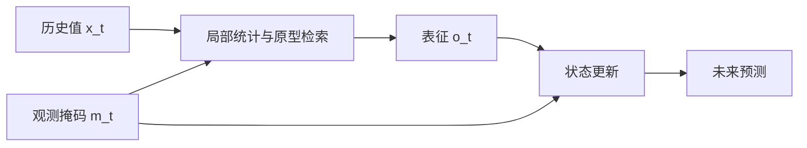

# S4M 所采用的状态空间结构及相近工作调研

检索日期：2026-10-16。范围是多变量时间序列预测、缺失观测/不规则采样，以及可作为时空预测骨干的深度状态空间模型（SSM）。本文把“预测未来”与“补全历史缺失值”严格区分：后者可以使用缺口两侧的观测，不能直接与只看预测时刻之前数据的预测器比较。

2026-10-16 原文复核更正：S4M 主要实验为全变量同步的时间块缺失和各变量独立生成的时间块缺失，不是散点与整变量永久缺失三类独立实验；附录 D.8 还包含 USHCN 气候数据。局部统计的正文举例与附录 C.1 的极值加权公式不同，不能只按“最近观测值＋间隔”概括实现。双向编码若仅访问预测起点之前的历史是合法的，越过预测起点读取未来真实值才构成泄漏。下面历史概括如有冲突，以本更正及同目录《S4M方法解析_局限与优化迁移分析.md》为准。

## 结论先行

有相近工作，而且已经形成了三条不同的路线。

1. **S4M 的直接同类**：把缺失模式显式送入状态更新或离散化，例如 S4M、MAS-Mamba、MAP-SSM；它们共同反对“先把缺失值填好，再做预测”的唯一处理方式。
2. **S4/SSM 作为生成式插补骨干**：SSSD、TIMBA。它们处理缺失能力较强，但主要报告的是插补，不应直接宣称解决了历史缺失条件下的因果预测。
3. **SSM/Mamba 作为一般预测或时空图骨干**：SpaceTime、S-Mamba、TimeMachine、STG-Mamba 等。这类工作说明 SSM 可建模时序或与图模块结合，却通常没有把观测掩码、缺口长度放进状态转移。

因此，若问题是“**S4M 的状态空间结构还有没有类似工作**”，最接近的已发表证据是 MAS-Mamba；最需要警惕的后续同类是 MAP-SSM（出版社页面标注的刊期晚于本次检索日，故不作为已发表基线）；SSSD 是最重要的 S4＋缺失生成式基线。把普通 Mamba 或 STG-Mamba 直接称作“缺失预测模型”并不准确。

## 1. S4M 到底用了什么结构

S4M（Peng et al., ICLR 2025）不是 Mamba，而是以 **S4** 为时序核的缺失感知预测器。[论文](https://arxiv.org/abs/2503.00900) | [官方代码](https://github.com/WINTERWEEL/S4M)

普通离散状态空间层可写成：

\[
h_t=\bar A h_{t-1}+\bar Bx_t,\qquad y_t=Ch_t+Dx_t.
\]

S4M 的 MDS-S4 不只输入表征 \(o_t\)，还将编码后的观测掩码作为第二条输入流；其核心可概括为：

\[
h_t=\bar A h_{t-1}+\bar B o_t+\bar E E_m(m_t),
\qquad y_t=Ch_t+Do_t+F E_m(m_t).
\]

这意味着它把“该值是否被观察到”当作状态更新的输入，而不是只用零、均值或前向填充替代 \(x_t\)。在其之前，ATPM 从最近观测值、距最近观测的时间等局部统计量中形成查询，在原型库中检索相似历史模式，再生成 \(o_t\)。原型库采用两层队列、相似度读取和动量更新。

需要准确理解的边界如下。

| S4M 已做到的事 | S4M 没有自动做到的事 |
|---|---|
| 掩码通过额外输入项影响状态与输出；ATPM 用历史模式补充表征。 | 掩码并没有直接将 \(\bar A\) 改成“缺失时专用的状态转移”；状态仍按离散步推进。 |
| 主实验人为构造全变量同步时间块和各变量独立时间块，再预测未来；另有 USHCN 实验。 | 没有面向带真实站点拓扑的时空图设计；论文中的跨变量关系不能等同于地理空间图。 |
| 端到端预测，不要求先输出一个完整的数值插补序列。 | ATPM 的“原型记忆”并不是尚未有人使用的机制；见后面的 MAP-SSM。 |

## 2. 直接相关：缺失/不规则观测下的 SSM 预测

下表按“与 S4M 的可比程度”而非论文名气排序。`直接`表示任务中历史输入本身不完整且目标是未来预测；`机制参考`表示状态演化高度相关，但任务不完全相同。

| 工作与发表状态 | 状态空间结构与缺失处理 | 任务、缺失模式、公开数据 | 与 S4M 的关系与可用性 |
|---|---|---|---|
| **S4M** — Peng et al., ICLR 2025 | S4；值表征流与掩码流共同进入 MDS-S4；ATPM 原型库使用局部统计。 | 多变量预测；全变量同步时间块、各变量独立时间块；ETTh1、Electricity、Traffic、Weather，另有 USHCN。 | 目标论文；直接基线。代码公开。 |
| **MAS-Mamba** — Huang & Chang, *IET Intelligent Transport Systems*, 2026, DOI [10.1049/itr2.70304](https://doi.org/10.1049/itr2.70304) | 选择性 SSM（Mamba）。将观测掩码与距上次有效读数的时间共同条件化离散步长 \(\Delta\)，使传感器断连时的隐状态保持或衰减，而非吸收填充值；5/15/45 分钟三尺度分支，另有区间预测头。 | 短期道路交通预测；MCAR、NMAR 和传感器断连；METR-LA（207）与 PEMS-BAY（325）。 | **最相近的正式发表工作**：直接预测、掩码进入状态转移、真实道路传感器场景。其轻量版不依赖图，另有道路图变体。出版社正文访问受限，本条机制与数据来自可公开索引摘要及作者发表记录，应在正式写作时下载原文复核具体公式与数值。 |
| **Mamba-NTP** — Xu et al., *Journal of Network and Computer Applications* 244 (2025) 104364, DOI [10.1016/j.jnca.2025.104364](https://doi.org/10.1016/j.jnca.2025.104364) | Mamba 作为端到端网络流量矩阵完成、图学习和预测骨干；输入测量稀疏。 | 通信网络的 traffic matrix 预测与补全；稀疏测量/不完整矩阵，非道路流量。 | 直接涉及“稀疏观测＋预测”，但数据对象、空间关系和掩码协议不同，适合借鉴端到端联合完成—预测设计，不能替代 METR-LA 类道路基线。 |
| **EMIRA** — Zhong, 博士论文（HKUST, 2026） | 在 Mamba 扫描中加入全局不规则性上下文（context-aware selectivity），并用预测查询检索相关观测（query prompting）。 | 不规则多变量时间序列预测。 | 对“时间间隔应影响状态扫描”最接近，但目前可核实载体是学位论文而非独立同行评议论文；可作机制参考，不能与正式期刊/会议成果并列。 [论文库记录](https://researchportal.hkust.edu.hk/en/studentTheses/multivariate-time-series-analysis-with-deep-learning/) |
| **CRU** — Schirmer et al., ICML 2022 | 连续时间隐状态通过 Kalman–Bucy 型演化推进，在真正观测到数据时做 Kalman 更新并追踪不确定性。 | 不规则采样时间序列，以插值/表示学习为主要验证。 | 这是“让实际 \(\Delta t\) 控制状态转移”的经典深度连续时间参考，但并非 S4/Mamba，也不是 S4M 式公开预测基准。 [论文](https://proceedings.mlr.press/v162/schirmer22a.html) |

### 必须单列的后续工作：MAP-SSM

Li & Liu 的 **MAP-SSM: Missing-aware Prototype-guided State Space Model for Multivariate Time Series Forecasting** 与 S4M 的相似度极高：一方面用 `Missing-Gated Discretization` 按掩码调节离散化和状态衰减，另一方面以原型记忆提供缺口中的隐变量先验。[出版社页面](https://www.sciencedirect.com/science/article/pii/S0925231226023301) | [仓库](https://github.com/L1-1001/MAP-SSM)

但截至本次检索日，出版社页面列出的刊期为 **2026-12-07**，首次在线日期未核实；未来刊期本身不代表尚未在线发表。其仓库也明确说明只发布数据接口与缺失协议，尚未发布模型、训练管线或完整复现实验。因此：

- 应标注首次上线日期待核实，且不能写成完整代码已经可复现的基线；
- 它足以构成选题查重风险：单纯提出“掩码控制 SSM 离散化＋原型记忆”不应再作为创新点；
- 若之后论文正式上线，应将它加入最优先的直接对比组。

## 3. 重要但不应混为“缺失预测”的相近工作

| 工作 | 核心结构 | 已验证任务和数据 | 正确定位 |
|---|---|---|---|
| **SSSD** — Lopez Alcaraz & Strodthoff, TMLR 2022 | 条件扩散模型的去噪网络以 S4 为骨干（SSSD-S4）。 | 插补覆盖随机、MNAR、blackout；也把末段整体遮住作为预测，在 Solar（168→24）和 ETTm1 上评估；插补还含 METR-LA、PEMS-BAY。 | S4＋缺失最重要的公开基线。其预测协议是“未来尾段遮住”，和历史窗口内有随机/块缺失的预测需分开汇报。 [论文](https://arxiv.org/abs/2208.09399)；[代码](https://github.com/AI4HealthUOL/SSSD) |
| **TIMBA** — Solís-García et al., arXiv 2024 | 在 PriSTI/CSDI 式扩散插补框架中，以双向 Mamba 替换时间 Transformer；空间端仍是图消息传递与节点 Transformer。 | **插补**；AQI-36（36 个北京站点，原始缺失率 13.24%）、METR-LA、PEMS-BAY；块缺失、散点缺失和历史掩码。 | 与 AQI-36 和时空缺失最接近，但不是未来预测器。历史窗内双向编码可用于预测；必须避免读取预测起点之后的真实观测。论文仍为预印本，文中代码链接处于匿名状态。 [论文](https://arxiv.org/abs/2410.05916) |
| **GraphS4mer** — Tang et al., CHIL 2023 | 每节点 S4 时序编码＋动态图结构学习。 | EEG 癫痫检测、睡眠分期、ECG 分类。 | 说明 S4 与动态图能结合；它不是缺失预测，也不是交通预测论文。不能把它当成直接实验基线。 [论文](https://proceedings.mlr.press/v209/tang23a.html) |
| **STG-Mamba** — Li et al., arXiv 2024 | ST-S3M 选择性状态空间模块＋多时间粒度嵌入融合。 | 常规时空预测；PEMS04（307）、KnowAir（184）、HZ-Metro（80）。 | 说明 Mamba 可做时空图预测，仓库公开；没有针对观测缺失的协议或状态转移。 [论文](https://arxiv.org/abs/2403.12418)；[代码](https://github.com/LincanLi-X/STG-Mamba) |
| **S-Mamba** — Wang et al., *Neurocomputing* 619 (2025) 129178 | 对每个变量形成 token，用**双向 Mamba 沿变量维度**建模变量相关性，再用 FFN 学时序。 | 一般多变量长预测，覆盖 ETT、Electricity、Traffic、Weather、PEMS 等。 | 常被误解成“时间方向 Mamba”。它主要扫描变量维，不是将普通时间编码器直接换成 Mamba 的证据，也不处理缺失。 [论文](https://doi.org/10.1016/j.neucom.2024.129178)；[代码](https://github.com/wzhwzhwzh0921/S-D-Mamba) |
| **TimeMachine** — Ahamed & Cheng, ECAI 2024 | 四个 Mamba 处理局部/全局、多尺度以及通道混合/独立性。 | 一般长时预测。 | 多尺度 Mamba 的预测骨干参考，不处理缺失。 [论文](https://journals.sagepub.com/doi/10.3233/FAIA240677)；[代码](https://github.com/Atik-Ahamed/TimeMachine) |
| **SpaceTime** — Zhang et al., ICLR 2023 | 以 companion matrix 参数化离散 SSM，并以 closed-loop 支持多步预测。 | 预测、ECG/语音分类。 | 对“为何不必照搬 HiPPO/S4 结构、而可选择不同状态转移参数化”很有价值；无缺失建模。 [论文](https://openreview.net/pdf?id=2EpjkjzdCAa) |
| **S5** — Smith et al., ICLR 2023 | 一个 MIMO SSM 替代多组 SISO S4，利用并行 scan。 | 长序列任务。 | S4 工程替代层，适合效率消融或实现参考；不是缺失预测方法。 [论文](https://mlanthology.org/iclr/2023/smith2023iclr-simplified/) |
| **Time-SSM** — Hu et al., arXiv 2024 | 从动态谱算子角度解释 SSM，并提出紧凑预测模型。 | 一般预测。 | 可作为选择 SSM 参数化、patching 和初始化时的理论参考；公开可核实版本为预印本。不要与该团队 2026 年 KDD 的 *How to Train Your Mamba for Time Series Forecasting* 简单当作同一篇论文。 [预印本](https://arxiv.org/abs/2405.16312) |

## 4. 从“状态如何跨越缺口”划分方法，而不是只按论文名称罗列

| 类别 | 状态如何处理缺失 | 代表工作 | 对缺失预测的含义 |
|---|---|---|---|
| 值填补后递推 | 先以零、均值、前向填充或插补值替代，再照常更新。 | 常规 RNN/Transformer/Mamba 管线。 | 模型容易把“填补值”误视为真实观测；普通 Mamba 并不会天然识别缺失。 |
| 掩码作为附加输入 | 掩码进入输入/输出通道，但状态转移矩阵未必改变。 | S4M 的 MDS-S4。 | 可以区分观测与未观测；对长连续缺口仍要检验状态是否过度遗忘。 |
| 掩码或间隔调节状态转移 | 用 \(m_t\)、距最近观测的时间或真实 \(\Delta t\) 改变离散化/演化。 | MAS-Mamba、MAP-SSM、CRU、EMIRA。 | 最贴近传感器断连与不规则采样；也是当前直接竞争最集中的方向。 |
| 隐变量先验/记忆 | 缺口内从相似历史模式或概率分布取隐变量支持。 | S4M 的 ATPM、MAP-SSM、SSSD。 | 有助于跨缺口，但“原型/记忆”本身已非空白创新。 |
| 图空间与状态演化分解 | 时间由 SSM，空间由固定图、学习图或消息传递。 | GraphS4mer、STG-Mamba、TIMBA、MAS-Mamba+Spatial。 | 对站点数据必要，但图建模本身不能替代缺失可观测性建模。 |

## 5. 对现有缺失时空预测工作的实际启示

结合已有 DRR-MSGF/MR-MSGF 的“物理图＋学习的观测图＋多尺度时间编码”基础，下面的判断比“把编码器换成 Mamba”更可靠。

1. **可做、且需要正面比较的改变**：研究“掩码和缺口长度是否应控制状态传播”，需要与 S4M、MAS-Mamba、普通 S4/Mamba 的同参数量版本比较。其问题不是 SSM 是否更强，而是连续缺失时状态是否应更新、保持或按多大幅度衰减。
2. **可保留的已有优势**：现有的共观测支持度约束学习图，处理的是“邻居在同一时刻是否可靠”；上述直接 SSM 工作多处理单条序列如何跨时间缺口。二者针对的维度不同，但必须通过消融证明图可靠性与状态可靠性各自带来增益。
3. **不能单独作为创新的内容**：泛泛的“多尺度 Mamba”、原型记忆、掩码进入网络、图＋Mamba，都已有先例；MAP-SSM 又覆盖了“缺失门控离散化＋原型”这一组合。
4. **可选但会扩大工作量的方向**：MAS-Mamba 表明预测区间可以与传感器缺失预测结合，但不宜把不确定性头、图学习、原型记忆和新 SSM 同时作为一篇小工作的主线。

## 6. 后续实验中必须统一的协议

若后续把 SSM 方法用于 AQI-36、METR-LA 或 PEMS-BAY，建议把下面项目写成实验协议，而不是在不同论文的表格间直接比较。

1. 训练/验证/测试按时间切分，标准化统计量只由训练集计算。
2. 预测时只允许使用预测起点以前的观测；历史插补模型可以在预测起点以前的历史窗内双向扫描，但不得访问预测起点之后的真实观测。
3. 每个数据集分别报告散点缺失、连续块缺失、变量/站点缺失；同时报告原始缺失和额外人工遮挡的处理方式。
4. 对块缺失至少分长度报告，而非只报告总缺失率；连续 1、3、6、12 个采样步的困难不同。
5. 将“仅时间骨干”“仅图空间模块”“完整模型”做参数量接近的消融，并报告 MAE、RMSE/MSE、训练与推理时间。若有区间预测，另报告覆盖率和区间宽度。

## 7. 文献质量与检索边界

- 已核对全文或官方出版页的核心来源：S4M、SSSD、TIMBA、CRU、GraphS4mer、STG-Mamba、SpaceTime、S5、S-Mamba、TimeMachine、Mamba-NTP。
- MAS-Mamba 的 DOI、作者、期刊、数据集和摘要已核对；期刊全文未能通过当前访问通道取得，因此具体公式、指标数值不在本文转述。
- MAP-SSM 是未来刊期页面与不完整预发布仓库，保留为“高风险后续工作”，不列入已发表可复现实验组。
- 未纳入“名称含 Mamba 但任务是分类、异常检测、医学结局预测”的论文；它们不能回答缺失条件下的未来数值预测问题。

## 参考文献与链接

1. J. Peng, M. Yang, Q. Zhang, X. Li. *S4 for Multivariate Time Series Forecasting with Missing Values*. ICLR 2025. [arXiv](https://arxiv.org/abs/2503.00900).
2. J. M. Lopez Alcaraz, N. Strodthoff. *Diffusion-based Time Series Imputation and Forecasting with Structured State Space Models*. TMLR, 2022. [arXiv](https://arxiv.org/abs/2208.09399).
3. C.-I. Huang, W.-Y. Chang. *MAS-Mamba: A Compact Missing-Aware Selective State-Space Model with Calibrated Uncertainty for Short-Term Traffic Forecasting under Sensor Outages*. IET Intelligent Transport Systems, 2026. [DOI](https://doi.org/10.1049/itr2.70304).
4. C. Xu, Y. Guo, H. Luo, Y. Yu, Z. Huang. *Mamba-NTP: Mamba-based Network Traffic Prediction with Sparse Measurements*. Journal of Network and Computer Applications 244, 104364, 2025. [DOI](https://doi.org/10.1016/j.jnca.2025.104364).
5. M. Schirmer et al. *Modeling Irregular Time Series with Continuous Recurrent Units*. ICML 2022. [PMLR](https://proceedings.mlr.press/v162/schirmer22a.html).
6. J. Solís-García et al. *TIMBA: Time Series Imputation with Bi-directional Mamba Blocks and Diffusion Models*. arXiv:2410.05916, 2024. [arXiv](https://arxiv.org/abs/2410.05916).
7. S. Tang et al. *Modeling Multivariate Biosignals With Graph Neural Networks and Structured State Space Models*. CHIL 2023. [PMLR](https://proceedings.mlr.press/v209/tang23a.html).
8. L. Li et al. *STG-Mamba: Spatial-Temporal Graph Learning via Selective State Space Model*. arXiv:2403.12418, 2024. [arXiv](https://arxiv.org/abs/2403.12418).
9. Z. Wang et al. *Is Mamba Effective for Time Series Forecasting?* Neurocomputing 619, 129178, 2025. [DOI](https://doi.org/10.1016/j.neucom.2024.129178).
10. M. A. Ahamed, Q. Cheng. *TimeMachine: A Time Series is Worth 4 Mambas for Long-Term Forecasting*. ECAI 2024. [DOI](https://doi.org/10.3233/FAIA240677).
11. M. Zhang et al. *Effectively Modeling Time Series with Simple Discrete State Spaces*. ICLR 2023. [OpenReview](https://openreview.net/pdf?id=2EpjkjzdCAa).
12. J. T. H. Smith, A. Warrington, S. Linderman. *Simplified State Space Layers for Sequence Modeling*. ICLR 2023. [ML Anthology](https://mlanthology.org/iclr/2023/smith2023iclr-simplified/).
13. Y. Li, T. Liu. *Missing-aware Prototype-guided State Space Model for Multivariate Time Series Forecasting*. Future-dated publisher record, 2026. [publisher record](https://www.sciencedirect.com/science/article/pii/S0925231226023301).

本调研的方法流程参考了 literature-review skill 的可复现检索、来源核验与任务边界筛选要求；该流程性工具本身不是本领域结论的证据来源。
